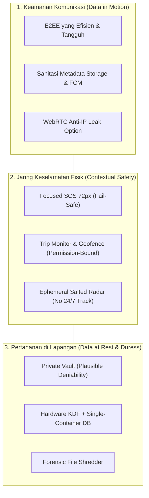
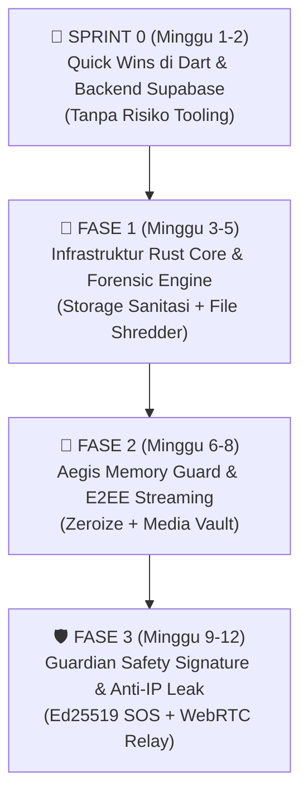

# 🛡️ CETAK BIRU STRATEGIS MEKAAR: SISTEM KEAMANAN PERSONAL & PRIVASI BERIMBANG

> **Dokumen Visi Arsitektur, Filosofi Produk & Roadmap Revisi**  
> **Status:** Dokumen Resmi Arah Pengembangan Jangka Menengah & Panjang (MEKAAR 2.0 / 3.0+)  
> **Basis Filosofi:** *Pragmatic Human Safety & Balanced Privacy* (Bukan Ekstremisme Cypherpunk, Bukan Kapitalisme Pengawasan)

---

## 🧭 BAB 1: MANIFESTO & FILOSOFI MEKAAR

### 1.1 Menolak Tirani Ekstremisme & Mengukir Identitas Sendiri

Di industri teknologi komunikasi saat ini, terdapat dikotomi biner yang menjebak:

1. **Kutub Kapitalisme Pengawasan (WhatsApp / Meta):**  
   Memberikan kenyamanan dan panggilan suara/video gratis, tetapi mengorbankan privasi metadata. Identitas terikat mutlak ke nomor telepon seluler; jejaring sosial, frekuensi interaksi, dan cap waktu dicatat untuk profil komersial.
2. **Kutub Teater Keamanan (Telegram):**  
   Menjual narasi "kebebasan", namun obrolan standar (*cloud chats*) tersimpan dalam keadaan *plaintext* di server mereka. Fitur keamanan sejati (*Secret Chats*) disembunyikan dan tidak mendukung sinkronisasi multi-perangkat.
3. **Kutub Paranoia Cypherpunk (Signal):**  
   Mencapai puncak kemurnian kriptografi dan nihil-metadata (*Zero Metadata*), tetapi menolak realitas kebutuhan perlindungan fisik manusia di dunia nyata. Signal tidak memiliki tombol darurat, tidak ada pemantauan perjalanan, tidak ada jaring pelindung keluarga (*Guardian Network*), dan tetap menuntut nomor telepon asli untuk registrasi.
4. **Kutub Kompleksitas Teknokratik (Matrix / Element):**  
   Kedaulatan data berbasis federasi terdesentralisasi, namun arsitekturnya rumit, proses sinkronisasi (*sync*) berat bagi ponsel kelas menengah-bawah, dan kurva adopsi pengguna awam sangat curam.

```
       [ WhatsApp ] ---------------- [ MEKAAR ] ---------------- [ Signal ]
  (Surveillance Capitalism)    (Human Safety & Balance)     (Paranoid Anonymity)
  Kenyamanan Tinggi            Proteksi Fisik + Kripto      Kripto Murni
  Privasi Metadata Nol         Privasi Terikat Konteks      Tanpa Jaring Pengaman Fisik
```

### 1.2 Siapa Pengguna Sebenarnya MEKAAR?

MEKAAR tidak dibangun untuk agen rahasia fiktif di film spionase. MEKAAR dibangun untuk **manusia nyata di dunia nyata**:
- **Wanita & Remaja** yang pulang kerja/kuliah larut malam melewati area sepi atau rawan begal.
- **Pekerja Lapangan & Pengemudi** yang rentan mengalami kecelakaan, intimidasi fisik, atau pemerasan di rute terpencil.
- **Keluarga & Sahabat** yang ingin memiliki ruang aman untuk saling menjaga tanpa rasa takut diintip atau dimata-matai.
- **Individu dalam Relasi Penuh Tekanan** yang membutuhkan perlindungan terhadap pemeriksaan paksa HP (*coercive device inspection*).

### 1.3 Nilai Inti: "Privasi Kontekstual & Keselamatan Fisik"

> [!IMPORTANT]
> **Aksioma MEKAAR:**  
> 1. *Privasi tanpa perlindungan fisik adalah kesia-siaan:* Kriptografi terkuat di dunia tidak ada gunanya jika korban diserang secara fisik di jalan dan tidak ada yang datang menolong.  
> 2. *Perlindungan fisik tanpa privasi adalah tirani:* Aplikasi pelacak lokasi keluarga konvensional bertindak seperti gelang pengawas narapidana—menghancurkan otonomi pribadi dan rentan disalahgunakan menjadi alat penguntit (*stalkerware*).  
> 3. **MEKAAR berdiri di titik keseimbangan:** Menjamin kerahasiaan penuh saat damai (*Peace State*), dan membuka jaring perlindungan terpercaya secara cepat dan deterministik saat bahaya (*Emergency State*).

---

## 🏛️ BAB 2: TIGA PILAR ARSITEKTUR PERTAHANAN BERLAPIS (*DEFENSE-IN-DEPTH*)

Untuk mewujudkan filosofi di atas, arsitektur MEKAAR dipecah menjadi tiga pilar pertahanan yang saling mengunci:



---

### PILAR 1: Keamanan Komunikasi yang Masuk Akal (*Sensible Cryptography*)

Bukan mengejar kerumitan algoritma di atas kertas, tetapi menutup celah kebocoran praktis:

1. **Evolusi E2EE Terukur:**
   - Pertahankan format pesan yang kompatibel mundur.
   - Pindahkan logika kripto ke mesin berkecepatan tinggi tanpa merusak kenyamanan *multi-device offline delivery*.
   - Tidak memerlukan *post-quantum cryptography* yang membengkakkan ukuran paket transmisi sebesar ribuan persen di jaringan seluler 3G/EDGE Indonesia. Cukup menggunakan kurva eliptik modern yang terbukti: **X25519 + XChaCha20-Poly1305 / Aegis**.
2. **Sanitasi Metadata Media (Zero Storage Fingerprinting):**
   - Media terenkripsi di Supabase Storage **dilarang memuat `roomId`, `userId`, atau ekstensi file asli** pada URL-nya.
   - Semua lampiran disimpan sebagai blob acak: `storage/v1/object/public/chat-media/{random_uuid}.bin`.
   - Ukuran file diberi *padding* acak kelipatan 16KB/64KB untuk mencegah penyerang menganalisis jenis file dari ukuran bytenya (*traffic analysis resistance*).
3. **Notifikasi Dorong Privat (Silent FCM Architecture):**
   - Firebase Cloud Messaging (Google) adalah pihak ketiga yang tidak boleh dipercaya.
   - Edge Function dilarang mengirimkan nama pengirim, foto profil, atau cuplikan isi pesan ke FCM.
   - FCM hanya mengirim sinyal bangun tak bermakna: `{"type": "sync", "v": 2}`. Aplikasi MEKAAR bangun di latar belakang, mengambil pesan terenkripsi langsung via TLS Supabase, dan merender notifikasi secara lokal di perangkat.
4. **Perlindungan IP Panggilan Suara/Video (WebRTC Relay Toggle):**
   - Sediakan saklar privasi: *"Sembunyikan Alamat IP Saat Menelpon"*.
   - Saat aktif, aplikasi mematikan kandidat STUN langsung (P2P) dan memaksakan seluruh aliran media melewati relay TURN terotentikasi. Lawan bicara tidak akan pernah bisa melacak ISP atau kota tempat pengguna berada.

---

### PILAR 2: Jaring Keselamatan Fisik (*Context-Bound Safety Network*)

Prinsip keselamatan MEKAAR membedakannya secara radikal dari semua aplikasi chat konvensional:

1. **SOS Bukan Sekadar Pesan Chat, Ini Protokol Penyelamatan Hidup:**
   - Tombol panik 72px (*Focused SOS*) dirancang untuk memicu alarm dalam waktu $< 200\text{ ms}$ bahkan saat pengguna panik, gemetar, atau layar retak.
   - **Prinsip Keandalan Jaringan Rendah (*Low-Bandwidth SLA*):** Sinyal darurat dioptimalkan agar dapat lolos di jaringan 1 bar sinyal. Paket darurat pertama adalah paket ultra-ringan ($< 1\text{ KB}$): `Timestamp + Signed Coordinates + Battery Level`.
   - Aliran streaming audio/video WebRTC hanya diaktifkan jika kapasitas *bandwidth* mencukupi, tanpa pernah memblokir pengiriman koordinat lokasi utama.
2. **Berbagi Lokasi Berbasis Sesi, Bukan Pengawasan 24/7:**
   - MEKAAR **menolak pelacakan lokasi latar belakang tanpa batas waktu**.
   - Lokasi hanya dibagikan dalam dua kondisi:
     1. **Kondisi SOS Aktif:** Hingga sesi diakhiri oleh pengguna atau Guardian.
     2. **Kondisi Trip Monitor:** Pengguna secara sadar mengaktifkan perjalanan dari titik A ke titik B dengan batas waktu (*countdown timer*) dan *auto check-in*.
   - Jika perjalanan selesai, akses lokasi langsung dicabut seketika (*instant revocation*).
3. **Radar Teman Sekitar Tanpa Koordinat Mentah (*Ephemeral Salted Radar*):**
   - Menghindari pengiriman latitude/longitude mentah ke database terbuka.
   - Lokasi diubah menjadi blok area (*geohash chunk*) yang dipadukan dengan *ephemeral daily salt* antar kontak terdaftar. Server hanya menghitung kedekatan relasi tanpa pernah mencatat peta jejak historis pengguna.

---

### PILAR 3: Pertahanan di Lapangan & Anti-Paksaan (*Field Forensics & Duress Defense*)

Ancaman terbesar bagi keamanan personal sering kali bukan peretas jarak jauh, melainkan **individu yang berada di depan mata pengguna**:

1. **Filosofi Plausible Deniability Kontekstual:**
   - Jika seseorang dipaksa di bawah ancaman fisik untuk membuka HP ("Buka chat kamu sekarang!"), menolak membuka HP akan memicu kekerasan fisik.
   - Pengguna harus bisa memasukkan **Duress PIN** (PIN Paksaan).
   - **Tampilan Umpan yang Meyakinkan (*High-Fidelity Decoy*):**
     - Layar yang terbuka BUKAN aplikasi kosong yang mencurigakan.
     - Layar yang terbuka adalah tampilan MEKAAR normal berisi kontak-kontak wajar (teman kerja, keluarga, grup belanja) dengan riwayat chat nyata yang tidak sensitif.
     - Di latar belakang secara senyap (*Silent Trigger*), sistem dapat mengirimkan notifikasi koordinat darurat ke Guardian pilihan tanpa suara atau getaran.
2. **Satu Wadah Penyimpanan Tersembunyi (*Single-Container Obfuscation*):**
   - Menghindari pembuatan dua file terpisah di direktori Android (`vault_real.db` vs `vault_decoy.db`) yang dapat segera terbongkar oleh alat forensik seperti Cellebrite atau inspeksi root.
   - Gunakan penyimpanan terpadu di mana data brankas rahasia (*Private Vault*) tersimpan dalam tabel terenkripsi dengan kunci KDF independen, atau kontainer data acak yang tidak memancarkan tanda-tanda keberadaan brankas kedua.
3. **Pemusnahan Berkas Fisik Nyata (*Forensic Shredder*):**
   - Fitur *View-Once Media* dan pembersihan riwayat obrolan (*Burn on Exit*) tidak cukup hanya memanggil `File.delete()`.
   - File sementara di-overwrite dengan byte acak dan byte `0x00`, dipaksa sinkronisasi ke chip memori fisik (`fsync`/`sync_all`), baru dilepas dari tabel file OS.

---

## 🦀 BAB 3: PERAN RUST vs FLUTTER (STRATEGI HYBRID PRAGMATIS)

Menulis ulang seluruh aplikasi ke Rust adalah tindakan boros yang memperlambat inovasi fitur antarmuka. Sebaliknya, membiarkan operasi kriptografi berat dan file I/O sensitif di Dart VM menimbulkan risiko residu memori.

Berikut adalah pembagian garis batas (*Architectural Boundary*) yang definitif:

```
┌─────────────────────────────────────────────────────────────────────────┐
│                     📱 FLUTTER LAYER (Dart)                            │
│  - Antarmuka Pengguna Tri-Register (Clean Core, 12 Tema, Focused SOS)    │
│  - Manajemen Status Terpusat (Riverpod StateNotifiers)                 │
│  - Orkestrasi Hardware OS (Kamera, Mic, GPS, Sensor Goyang Accelerometer)│
│  - Visualisasi OpenStreetMap (flutter_map) & WebRTC Video Renderer      │
└────────────────────────────────────┬────────────────────────────────────┘
                                     │ FFI Boundary (Zero-Copy async)
┌────────────────────────────────────┴────────────────────────────────────┐
│                  🦀 RUST SECURITY CORE (mekaar_aegis_core)              │
│  HANYA DIGUNAKAN UNTUK 4 TUGAS KRITIS DENGAN LEVERAGE TERTINGGI:        │
│  1. Memory Guard: Isolasi kunci rahasia & auto-zeroing RAM (secrecy)   │
│  2. Stream Vault: Enkripsi/dekripsi media chunk 64KB tanpa drop frame   │
│  3. Forensic Shredder: Penimpaan fisik berkas temporary + OS sync_all   │
│  4. Packet Signing: Tanda tangan digital Ed25519 untuk paket SOS cepat  │
└─────────────────────────────────────────────────────────────────────────┘
```

> [!TIP]
> **Keputusan Arsitektur:**  
> Rust **TIDAK** mengambil alih manajemen koneksi HTTP/Websocket Supabase, tidak mengurus routing halaman, dan tidak merender widget. Rust hadir sebagai **Perisai Khusus (*Aegis Core*)** di lapisan terbawah.

---

## 🗺️ BAB 4: ROADMAP REVISI BERBASIS DAMPAK NYATA

Roadmap ini menggantikan versi sebelumnya. Prioritas diurutkan berdasarkan **leverage keamanan tertinggi dengan risiko gangguan operasional terendah**:



---

### 🚀 SPRINT 0: Hardening Cepat di Dart & Supabase (Minggu 1 - 2)
**Fokus:** Menutup celah keamanan yang ada di kode saat ini sebelum menyentuh Rust.

- [ ] **KDF Hardening:** Naikkan parameter Argon2id di [`e2ee_service.dart`](file:///C:/Users/fabian%20nuriel/Mekaar_chat/lib/data/services/e2ee_service.dart) menjadi 64MB memory cost, 3 iterasi, 4 paralel.
- [ ] **Ganti Salt Hardcoded:** Buang salt string statis di [`database_key_service.dart`](file:///C:/Users/fabian%20nuriel/Mekaar_chat/lib/data/services/database_key_service.dart). Gunakan salt acak 32-byte unik per perangkat yang disimpan di `FlutterSecureStorage`.
- [ ] **Sanitasi Media Storage:** Ubah pola penamaan upload di [`media_upload_service.dart`](file:///C:/Users/fabian%20nuriel/Mekaar_chat/lib/data/services/media_upload_service.dart) dari `$roomId/${userId}_$timestamp$ext` menjadi `${Uuid().v4()}.bin`. Hapus metadata identitas ruang dari URL penyimpanan.
- [ ] **Privatisasi FCM Push:** Modifikasi Supabase Edge Function `send-push-notification` agar tidak pernah mengirimkan nama pengguna atau teks pesan ke Firebase. Kirim hanya sinyal bangun anonim.

---

### 🦀 FASE 1: Infrastruktur Rust Core & Forensic Engine (Minggu 3 - 5)
**Fokus:** Menghubungkan Rust via `flutter_rust_bridge` v2 dan menyelesaikan masalah pemusnahan file fisik.

- [ ] Inisialisasi ruang kerja `rust/` (`mekaar_aegis_core`) menggunakan `cargokit`.
- [ ] Implementasikan modul **Forensic Shredder** di Rust:
  - Overwrite byte acak (`OsRng`) + zero-fill (`0x00`).
  - Panggil `std::fs::File::sync_all()` untuk memaksa penulisan fisik ke chip memori sebelum file dihapus.
- [ ] Ganti implementasi `shredFile()` di Dart agar mendelegasikan tugas ke Rust.
- [ ] Pasang CI/CD GitHub Actions multi-target (Android NDK + iOS).

---

### 🔐 FASE 2: Aegis Memory Guard & Streaming Media Vault (Minggu 6 - 8)
**Fokus:** Menangani media besar tanpa lag dan menjamin kunci rahasia dihapus dari RAM.

- [ ] Implementasikan struktur data sensitif di Rust dengan crate `zeroize` dan `secrecy`.
- [ ] Bangun modul **Chunked Streaming Encryption (XChaCha20-Poly1305)** di Rust (potongan 64KB).
- [ ] Hubungkan *View-Once Media Player* dan *Voice Note Recorder* ke Rust stream cipher agar proses enkripsi/dekripsi file tidak memakan memori GC Dart atau menurunkan FPS animasi chat.
- [ ] Redesain brankas berkas (*Private Vault*) agar menyatu dalam satu kontainer database terenkripsi (*Single-Container Obfuscation*) untuk menjaga *plausible deniability*.

---

### 🛡️ FASE 3: Guardian Safety Signature & Anti-IP Leak (Minggu 9 - 12)
**Fokus:** Menjamin integritas sinyal darurat SOS dan privasi jaringan komunikasi.

- [ ] Implementasikan tanda tangan digital **Ed25519** di Rust:
  - Setiap paket darurat SOS (koordinat + waktu + identitas) ditandatangani secara kriptografis oleh perangkat pengirim.
  - Guardian memverifikasi tanda tangan ini untuk memastikan 100% anti-spoofing (server tidak dapat memalsukan panggilan minta tolong).
- [ ] Tambahkan saklar *"Sembunyikan Alamat IP Panggilan"* pada pengaturan chat:
  - Konfigurasi WebRTC untuk menonaktifkan kandidat STUN P2P dan hanya merutekan trafik via TURN relay saat saklar aktif.
- [ ] Rilis versi stabil **MEKAAR 2.0 (Aegis Edition)**.

---

## 📊 BAB 5: MATRIKS KEPUTUSAN: APA YANG DIBUANG & APA YANG DIPERTAHANKAN

| Fitur / Konsep | Status | Alasan Berbasis Prinsip Pertama & Realitas Lapangan |
| :--- | :---: | :--- |
| **Menulis Ulang UI ke Rust** | ❌ **DIBUANG** | Anti-pattern. Menghancurkan kecepatan iterasi, UI Tri-Register, dan 12 tema chat yang sudah dicintai pengguna. |
| **Pemisahan File `vault_decoy.db`** | ❌ **DIBUANG** | Cacat forensik. Keberadaan dua file berdampingan membuktikan adanya rahasia kedua kepada penyerang. |
| **Porting ECDH Statis Lama ke Rust** | ❌ **DIBUANG** | Jangan buang energi mem-porting arsitektur tanpa *forward secrecy*. Lompat langsung ke format modern saat Rust diintegrasikan. |
| **Tuntutan Zero-Metadata Total ala Signal** | ❌ **DIBUANG** | Bertentangan dengan fungsi penyelamatan hidup. Fitur SOS dan Guardian mutlak butuh berbagi koordinat darurat secara cepat. |
| **UI Tri-Register (Clean, Colorful, SOS)** | ✅ **DIPERTAHANKAN** | Identitas emosional dan ergonomi keselamatan MEKAAR yang sangat matang. |
| **Registrasi Berbasis Username & QR Luring** | ✅ **DIPERTAHANKAN** | Jauh lebih privat daripada WhatsApp/Signal yang mewajibkan nomor telepon seluler. |
| **Supabase Backend + RLS** | ✅ **DIPERTAHANKAN** | Efisien, handal, dan mendukung realtime darurat. Yang diperbaiki adalah sanitasi payload-nya, bukan mengganti servernya. |
| **OpenStreetMap (`flutter_map`)** | ✅ **DIPERTAHANKAN** | Bebas dari pelacakan komersial Google Maps SDK. |

---

## 🎯 BAB 6: KESIMPULAN & IDENTITAS MEKAAR KE DEPAN

MEKAAR tidak pernah berniat menjadi tiruan WhatsApp, salinan Telegram, ataupun klon kaku dari Signal. 

MEKAAR hadir untuk mengisi ruang kosong yang diabaikan oleh raksasa Silicon Valley: **sebuah aplikasi perlindungan personal yang hangat, manusiawi, indah secara estetika, namun memiliki fondasi keamanan sekuat baja saat penggunanya menghadapi bahaya fisik nyata di dunia.**

Roadmap revisi ini adalah panduan praktis, terukur, dan berbasis logika untuk membangun masa depan tersebut tanpa terjebak dalam ilusi teknis yang tidak memberi manfaat nyata bagi keselamatan pengguna.
