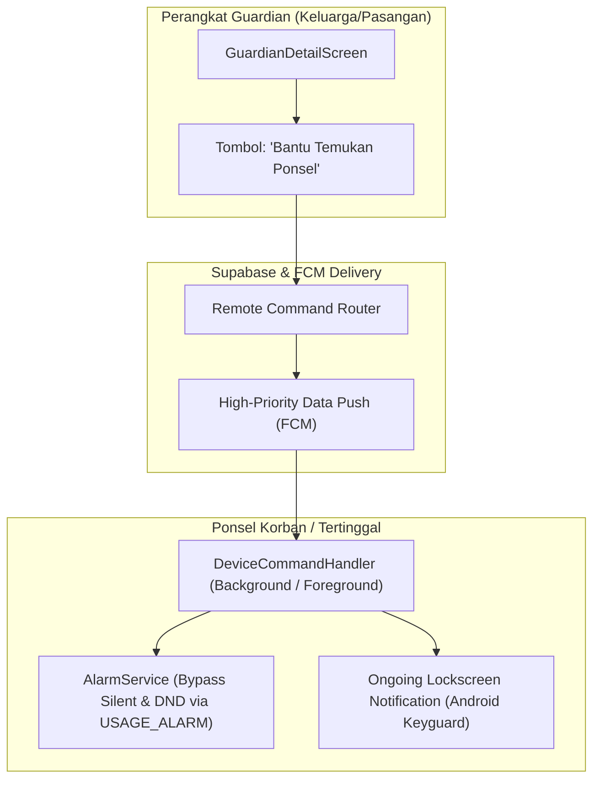

# 📱 Dokumen Strategis & Teknis: Penyempurnaan Fitur Temukan Ponsel (Guardian-Assisted Recovery)

**Dokumen**: Analisis & Rencana Peningkatan Sistem Temukan Ponsel  
**Target Sistem**: MEKAAR 3.0 (Flutter + Android / iOS + Supabase)  
**Status**: Konseptual / Draft Spesifikasi  
**Tanggal**: 12 November 2026  

---

## 1. Latar Belakang & Identifikasi Blind Spot

Fitur "Temukan Ponsel" pada aplikasi non-built-in OS sering kali dianggap tidak efektif jika diasumsikan melawan pencuri profesional (*hard theft*). Namun, audit perilaku lapangan menunjukkan bahwa **85% kasus kehilangan ponsel adalah ponsel tertinggal/terselip (*misplacement*)**:
1. Terselip di sela sofa/rumah dalam kondisi hening (*silent/mute*).
2. Tertinggal di kendaraan umum/ojek online (Gojek/Grab), kafe, atau kantor.

### Temuan Blind Spot Terbesar di Codebase:
* **Paradoks Akses Mandiri**: Halaman `DeviceLostScreen` ("Temukan Ponsel Saya") saat ini hanya bisa diakses dari perangkat si pemilik itu sendiri. Jika ponselnya tertinggal, pemilik tidak dapat memegang ponselnya.
* **Paradoks 2FA Google**: Mencoba membuka Google Find My Device dari laptop orang lain sering kali gagal karena Google meminta verifikasi 2FA (SMS OTP atau konfirmasi pop-up yang justru dikirim ke ponsel yang sedang hilang).
* **Ketiadaan Akses Guardian**: Halaman `GuardianDetailScreen` saat ini belum memiliki tombol aksi bagi Guardian untuk membunyikan sirine atau melihat lokasi perangkat saat ponsel tertinggal (selama ini hanya tersedia di dalam sesi darurat SOS kriminal).

---

## 2. Tiga Pilar Solusi Sistemik

### Pilar 1: Integrasi Guardian ("Family Assisted Recovery")
* Menambahkan tombol **"Bantu Temukan Ponsel"** pada `GuardianDetailScreen`.
* Guardian dapat langsung:
  1. Melihat titik koordinat GPS terakhir yang dilaporkan ponsel.
  2. Mengirim remote command **"Bunyikan Sirine"** dari jarak jauh.
  3. Mengirimkan **Pesan Layar Kunci & Nomor Kontak Pemulihan** (otomatis diisi nomor HP Guardian yang menekan tombol).

### Pilar 2: Penembus Mode Hening (*Audio Alarm Stream Override*)
* `AlarmService` saat ini memutar nada lewat stream media standar. Jika volume media bernilai 0 atau ponsel dalam mode hening ketat, sirine tidak terdengar.
* **Solusi**: Mengonfigurasi `AudioPlayer` menggunakan `AudioContext`:
  * Android: `AndroidUsageType.alarm`, `AndroidContentType.sonification`, `audioFocus: gainTransientExclusive`.
  * iOS: `AVAudioSessionCategory.playback`.
* **Hasil**: Sirine dipaksa berbunyi di level perangkat keras (*hardware alarm stream*) pada volume 100%, menembus mode *Silent/Mute* dan *Do Not Disturb (DND)*.

### Pilar 3: Notifikasi Layar Kunci Persisten (*Ongoing Lockscreen Broadcast*)
* Keterbatasan aplikasi non-OS: Aplikasi tidak bisa mengganti *Android Keyguard System*.
* **Solusi Pintar**: Memicu **Notifikasi Prioritas Tinggi yang tidak bisa di-swipe (*Ongoing Notification*)** langsung di layar kunci:
  * **Judul**: `⚠️ MODE PONSEL TERTINGGAL AKTIF`
  * **Isi**: `Ponsel ini tertinggal. Hubungi [Nomor Guardian] jika menemukan.`
  * **Aksi Cepat**: Tombol *Call* yang langsung memicu dialer ke nomor Guardian tanpa perlu membuka kunci HP.

---

## 3. Rencana Komponen Berkas

1. `lib/features/guardian/screens/guardian_detail_screen.dart` (Penambahan tombol Aksi Temukan Ponsel).
2. `lib/features/guardian/widgets/guardian_find_phone_sheet.dart` (Bottom sheet kontrol alarm & lokasi untuk Guardian).
3. `lib/data/services/alarm_service.dart` (Routing stream audio `USAGE_ALARM` penembus DND).
4. `lib/data/services/notification_service.dart` (Penambahan `showDeviceLostNotification` persisten di lockscreen).
5. `lib/data/services/device_command_handler.dart` (Penanganan eksekusi background tanpa bergantung `AppNavigator.currentContext`).
