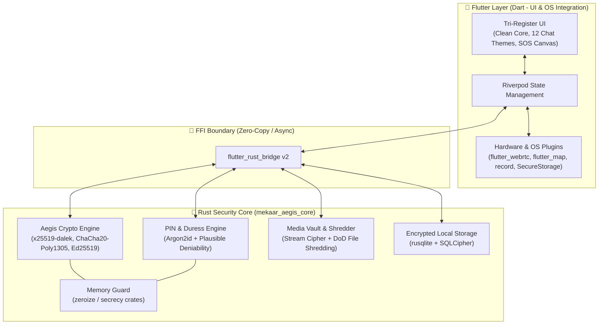

# 🛡️ MEKAAR 2.0: Roadmap Migrasi & Evolusi Arsitektur (Flutter + Rust Hybrid)

> **Dokumen Strategi Teknis & Arsitektur Keamanan**  
> **Target Proyek:** [Mekaar_chat](https://github.com/tholeteplok/Mekaar_chat)  
> **Pendekatan:** *Strangler Fig Pattern* (Pertahankan UI Flutter Tri-Register, Migrasikan *Security & Cryptography Core* ke Rust via `flutter_rust_bridge` v2).

---

## 📌 1. Visi & Filosofi Arsitektur

Berdasarkan fondasi **MEKAAR 3.0** yang sudah memiliki sistem UI/UX **Tri-Register** yang matang, integrasi **WebRTC**, **Supabase**, serta **237+ automated tests**, menulis ulang antarmuka (UI) ke Rust bukanlah langkah yang efisien. Sebaliknya, MEKAAR akan mengadopsi arsitektur standar industri aplikasi privasi kelas dunia (seperti *Signal* dan *Element X/Matrix*):

* **Flutter (Dart) sebagai Presentation & Hardware Orchestrator:** Menangani seluruh *rendering* UI (Clean Core, 12 tema Colorful Room, Focused SOS), manajemen *state* Riverpod, pemetaan OpenStreetMap (`flutter_map`), serta antarmuka perangkat keras (`flutter_webrtc`, sensor GPS, kamera, mikrofon).
* **Rust (`mekaar_aegis_core`) sebagai Zero-Knowledge Security Engine:** Menangani seluruh operasi kriptografi, manajemen kunci di memori aman (*auto-zeroing RAM*), derivasi PIN anti-*bruteforce*, enkripsi *streaming* untuk *View-Once Media*, dan *database* lokal terenkripsi penuh (SQLCipher).

### Diagram Arsitektur Target (MEKAAR 2.0)



---

## 🗺️ 2. Ringkasan Fase Pengembangan (Timeline & Milestone)

| Fase | Fokus Utama | Estimasi Durasi | Dampak pada UI & Server | Target Rilis |
| :--- | :--- | :--- | :--- | :--- |
| **Fase 0** | Setup Tooling, FFI Bridge & CI/CD Multi-Target | 1 - 2 Minggu | **Nol** (Tidak ada perubahan fitur) | `v3.1.0-alpha` |
| **Fase 1** | Migrasi *Aegis Protocol E2EE* & *RAM Zeroing* ke Rust | 2 - 3 Minggu | **Nol** (Kompatibel mundur dengan payload 3.0) | `v3.2.0` |
| **Fase 2** | *Hardening* Auth: Argon2id, *Cryptographic Duress PIN* & SQLCipher | 3 - 4 Minggu | Migrasi penyimpanan lokal otomatis | `v3.5.0` |
| **Fase 3** | *Media Vault Streaming Encryption* & *Secure File Shredder* | 2 - 3 Minggu | Peningkatan FPS UI saat buka media besar | `v3.8.0` |
| **Fase 4** | *SOS Packet Signing*, *Zero-Knowledge Radar* & *Double Ratchet* | 4 - 6 Minggu | Pembaruan protokol komunikasi Supabase | `v4.0.0 (Major)` |

---

## 🛠️ 3. Rincian Eksekusi Per Fase

### Fase 0: Persiapan Infrastruktur & `flutter_rust_bridge` (Fondasi)
**Tujuan:** Menyiapkan ruang kerja Rust di dalam repositori `Mekaar_chat` tanpa merusak 237 *unit/widget test* yang sudah ada.

* **Langkah Kerja:**
  1. Inisialisasi `flutter_rust_bridge` v2 menggunakan `cargokit` (otomatis mengurus kompilasi NDK Android dan Xcode/LLVM iOS saat menjalankan `flutter run` atau `flutter build`).
  2. Buat direktori `rust/` di *root* proyek dengan nama crate `mekaar_aegis_core`.
  3. Buat struktur modul di dalam `rust/src/`:
     * `api/` (Fungsi yang diekspos ke Dart)
     * `crypto/` (Mesin X25519, ChaCha20-Poly1305, HKDF)
     * `vault/` (Manajemen SQLCipher & Media Stream)
     * `guardian/` (SOS Signing & Geohash Anonim)
  4. Perbarui *workflow* **GitHub Actions** agar menyertakan instalasi `rustup` dan target kompilasi silang (`aarch64-linux-android`, `armv7-linux-androideabi`, `x86_64-linux-android`, `aarch64-apple-ios`).

* **Definition of Done (DoD):**
  * Fungsi `ping_aegis_core()` dari Rust berhasil dipanggil dari Riverpod *provider* di Dart.
  * Seluruh 237 *test* lama ditambah 1 *integration test* FFI berjalan hijau di GitHub Actions.

---

### Fase 1: Migrasi Aegis Protocol E2EE & Proteksi Memori (RAM Zeroing)
**Tujuan:** Menggantikan implementasi kriptografi Dart di `lib/data/` dengan crate Rust yang tahan serangan *side-channel* dan menjamin kunci rahasia langsung dihapus dari RAM setelah digunakan.

* **Masalah yang Diselesaikan:**
  * *Garbage Collector* (GC) Dart tidak mengizinkan penghapusan paksa (*zeroing*) *private key* di RAM.
* **Crate Rust yang Digunakan:**
  * `x25519-dalek` (RFC 7748 Key Exchange)
  * `chacha20poly1305` (RFC 8439 AEAD Cipher)
  * `hkdf` & `sha2` (RFC 5869 Key Derivation)
  * `zeroize` & `secrecy` (Penghapusan otomatis *bytes* sensitif di RAM dengan `0x00` saat variabel keluar dari *scope*)
  * `rand_core` (`OsRng` untuk generator angka acak berbasis hardware OS)

* **Langkah Kerja:**
  1. Implementasikan struktur `SecretKey` di Rust dengan anotasi `#[derive(Zeroize, ZeroizeOnDrop)]`.
  2. Pindahkan proses *Key Generation*, *Shared Secret Agreement* (`X25519`), dan derivasi `HKDF-SHA256` ke Rust.
  3. Buat jembatan API `aegis_encrypt_payload()` dan `aegis_decrypt_payload()` yang mempertahankan format *output* (Nonce + Ciphertext + MAC Tag) yang **100% identik** dengan versi Dart saat ini agar pesan lama di Supabase tetap terbaca.
  4. Ganti isi *repository* enkripsi di `lib/data/` agar memanggil fungsi Rust, sementara *signature* method Dart-nya tetap sama (sehingga kode di `lib/features/chat/` tidak perlu diubah).

* **Definition of Done (DoD):**
  * *Test vector* kriptografi di Dart dan Rust menghasilkan *ciphertext* yang kompatibel.
  * Tidak ada lagi *Private Key* mentah yang disimpan sebagai `Uint8List` atau `String` berumur panjang di sisi memori Dart.

---

### Fase 2: Hardening PIN, Cryptographic Duress Mode & SQLCipher
**Tujuan:** Mengamankan data lokal di perangkat dari bedah forensik (*rooted device extraction*) dan menerapkan *Plausible Deniability* sejati untuk fitur **Duress PIN** (PIN Paksaan).

* **Masalah yang Diselesaikan:**
  * Hashing PIN dengan `SHA-256 + Salt` terlalu cepat dan rentan di-*bruteforce* secara *offline* jika penyerang menyalin data aplikasi dari HP.
  * *Duress PIN* yang hanya berbasis logika UI (`if-else`) mudah dibongkar dengan menginspeksi *database* lokal secara langsung.
* **Crate Rust yang Digunakan:**
  * `argon2` (Konfigurasi **Argon2id**: *Memory-hard KDF* yang tahan serangan GPU/ASIC).
  * `rusqlite` dengan fitur `bundled-sqlcipher` (Database SQLite dengan enkripsi halaman penuh AES-256).

* **Langkah Kerja:**
  1. **Upgrade KDF PIN:** Ganti validasi PIN `SHA-256` dengan `Argon2id` (misal: *memory cost* 64 MB, *iterations* 3, *parallelism* 4). Satu kali tebakan PIN akan membutuhkan ~400ms, membuat *offline brute-force* mustahil dilakukan.
  2. **Arsitektur Dual-Vault (Duress PIN Sejati):**
     * Jangan simpan hash PIN di penyimpanan biasa. Gunakan `Argon2id(Input_PIN + Device_Salt)` untuk menghasilkan 256-bit *Database Encryption Key*.
     * **PIN Utama** menghasilkan `Key_Primary` $\rightarrow$ membuka `vault_primary.db` (berisi chat dan brankas asli).
     * **Duress PIN** menghasilkan `Key_Decoy` $\rightarrow$ membuka `vault_decoy.db` (berisi riwayat chat umpan/biasa yang tampak wajar) sekaligus memicu sinyal darurat senyap (*Silent SOS*) ke jaringan Guardian di latar belakang.
  3. Pindahkan manajemen *Private Vault Cloaking* ke dalam SQLCipher di Rust.

* **Definition of Done (DoD):**
  * File database lokal di direktori aplikasi tidak dapat dibuka menggunakan `sqlite3` standar (murni berupa *random bytes* tanpa kunci dari Argon2id).
  * Memasukkan Duress PIN membuka database umpan dengan mulus dalam waktu $< 500\text{ ms}$.

---

### Fase 3: Media Vault Streaming & Secure File Shredding (View-Once)
**Tujuan:** Memproses enkripsi/dekripsi foto, video, dan pesan suara berukuran besar tanpa membebani UI *thread* Flutter, serta memastikan file *View-Once Media* benar-benar musnah dari blok penyimpanan fisik (*storage blocks*).

* **Masalah yang Diselesaikan:**
  * Dekripsi file besar di memori Dart berisiko memicu *Out-Of-Memory (OOM)* atau menurunkan *frame rate* animasi *chat room*.
  * Menghapus file biasa dengan `File.delete()` di Dart hanya menghapus *pointer* di tabel file OS; datanya masih bisa dipulihkan dengan *software recovery*.
* **Crate Rust yang Digunakan:**
  * `chacha20poly1305` (`StreamBE32` untuk enkripsi per *chunk* 64KB).
  * Operasi I/O tingkat rendah (`std::fs::OpenOptions`, `std::io::Write::flush`, `sync_all`).

* **Langkah Kerja:**
  1. **Chunked Stream Encryption:** Buat fungsi di Rust yang membaca *path* file media dari kamera/mikrofon, mengenkripsinya per potong (*chunk* 64KB), dan langsung menulisnya ke file terenkripsi sebelum diunggah ke Supabase Storage.
  2. **In-Memory Media Streaming ke Flutter:** Saat pengguna melihat *View-Once Media* atau membuka *Private Vault*, Rust mendekripsi *stream* langsung ke *buffer* terbatas untuk di-render Flutter tanpa pernah menulis file *plaintext* (asli) ke penyimpanan HP.
  3. **Secure Shredder (`shred_file`):** Untuk file sementara yang terpaksa menyentuh *cache disk*, buat fungsi penghancur di Rust yang menimpa seluruh isi file dengan byte acak (`OsRng`), disusul byte nol (`0x00`), memanggil `fsync`, baru menghapusnya dari sistem file OS.

* **Definition of Done (DoD):**
  * Membuka video terenkripsi 50MB di ruang obrolan tetap menjaga animasi *scroll* Flutter di 60/120 FPS.
  * File *View-Once Media* yang sudah ditonton telah ditimpa secara kriptografis sebelum dihapus.

---

### Fase 4: SOS Packet Signing, Zero-Knowledge Radar & Double Ratchet
**Tujuan:** Meningkatkan protokol komunikasi jaringan MEKAAR ke level kriptografi tertinggi untuk fitur keselamatan publik (SOS & Guardian) dan *Forward Secrecy*.

* **Crate Rust yang Digunakan:**
  * `ed25519-dalek` (Tanda tangan digital kriptografis).
  * `vodozemac` (Implementasi *Olm/Megolm Double Ratchet* karya Matrix yang telah diaudit secara independen) atau implementasi *Signal Double Ratchet* kustom.

* **Langkah Kerja:**
  1. **Cryptographic SOS Verification (`Ed25519`):**
     * Setiap kali tombol panik SOS (72px) ditekan atau koordinat GPS darurat disiarkan, Rust menandatangani paket data (`Timestamp + Koordinat + Status Baterai + SDP WebRTC Fingerprint`) menggunakan kunci privat `Ed25519` milik pengirim.
     * Perangkat Guardian memverifikasi tanda tangan ini di modul Rust mereka. Ini menjamin **100% Anti-Spoofing**: bahkan jika server Supabase diretas, penyerang tidak bisa mengirimkan alarm SOS palsu atau memalsukan lokasi pengguna ke Guardian.
  2. **Zero-Knowledge Nearby Friends Radar:**
     * Alih-alih mengirim koordinat GPS mentah ke server untuk fitur *Nearby Friends Radar*, modul Rust mengubah lokasi pengguna menjadi **Salted Ephemeral Geohash** yang di-hash dengan kunci rotasi harian antar-teman. Server hanya mencocokkan kesamaan *hash* tanpa pernah tahu di kota atau jalan mana pengguna berada.
  3. **Evolusi Aegis E2EE ke Double Ratchet:**
     * Tingkatkan pertukaran kunci X25519 statis menjadi protokol **Double Ratchet** (seperti Signal). Setiap pesan yang dikirim menggunakan kunci simetris baru yang langsung dihancurkan setelah pesan didekripsi (*Forward Secrecy* & *Post-Compromise Security*).

* **Definition of Done (DoD):**
  * Paket sinyal SOS memiliki *signature* kriptografis yang terverifikasi oleh Guardian.
  * Pembocoran satu kunci sesi pesan tidak dapat digunakan untuk mendekripsi pesan masa lalu maupun masa depan.

---

## 📂 4. Struktur Direktori Proyek Setelah Integrasi (Target)

Struktur proyek Anda akan tetap bersih dengan pemisahan tanggung jawab yang tegas:

```text
Mekaar_chat/
├── assets/                  # Tetap (Logo, ikon kripto, suara sirene, ilustrasi Mika)
├── lib/                     # 🐦 FLUTTER LAYER (Presentation, Hardware & State)
│   ├── core/                # Tetap (Tri-Register Design Tokens, AppRoutes)
│   ├── bridge_generated/    # [BARU] Kode otomatis hasil generate flutter_rust_bridge
│   ├── data/                # Diperbarui: Memanggil fungsi Rust via bridge, urus Supabase & WebRTC
│   └── features/            # Tetap 100% (auth, chat 12-theme, guardian, map, settings, sos)
├── rust/                    # 🦀 RUST SECURITY CORE (mekaar_aegis_core)
│   ├── Cargo.toml           # Konfigurasi dependensi Rust (dalek, chacha20, argon2, rusqlite)
│   └── src/
│       ├── lib.rs           # Entry point modul Rust
│       ├── api/             # Ekspos fungsi bersih untuk dipanggil oleh Dart
│       │   ├── aegis_crypto.rs
│       │   ├── auth_pin.rs
│       │   ├── media_vault.rs
│       │   └── sos_guardian.rs
│       ├── crypto/          # Logika X25519, ChaCha20-Poly1305, HKDF, Ed25519, Zeroize
│       ├── storage/         # Engine SQLCipher (Primary DB vs Decoy Duress DB)
│       └── shredder/        # Engine penghancur file View-Once & Stream Cipher
├── supabase/                # Tetap (Migrasi skema PostgreSQL & RLS)
└── test/                    # Diperluas: 237 test Flutter + Cargo test untuk modul Rust
```

---

## 📦 5. Daftar Pustaka (Crates) `Cargo.toml` yang Direkomendasikan

Berikut adalah konfigurasi `rust/Cargo.toml` standar audit keamanan yang disiapkan untuk `mekaar_aegis_core`:

```toml
[package]
name = "mekaar_aegis_core"
version = "4.0.0"
edition = "2021"

[lib]
crate-type = ["cdylib", "staticlib"]

[dependencies]
# FFI Bridge ke Flutter
flutter_rust_bridge = "=2.4.0"
tokio = { version = "1.39", features = ["rt-multi-thread", "macros", "fs", "io-util"] }
anyhow = "1.0"

# Kriptografi Inti (Aegis Protocol)
x25519-dalek = { version = "2.0", features = ["static_secrets", "zeroize"] }
ed25519-dalek = { version = "2.1", features = ["rand_core", "zeroize"] }
chacha20poly1305 = { version = "0.10", features = ["stream"] }
hkdf = "0.12"
sha2 = "0.10"
rand_core = { version = "0.6", features = ["getrandom"] }

# Hardening PIN & Proteksi Memori RAM
argon2 = { version = "0.5", features = ["std"] }
zeroize = { version = "1.8", features = ["derive"] }
secrecy = { version = "0.8", features = ["serde"] }

# Penyimpanan Lokal Terenkripsi (Dual-Vault)
rusqlite = { version = "0.31", features = ["bundled-sqlcipher-vendored-openssl"] }

# Serialisasi Aman
serde = { version = "1.0", features = ["derive"] }
serde_json = "1.0"
bincode = "1.3"

[profile.release]
lto = true              # Link-Time Optimization untuk ukuran binary kecil & cepat
codegen-units = 1
strip = true            # Hapus simbol debug dari binary produksi agar sulit di-reverse engineer
opt-level = 3
panic = "abort"
```

---

## ✅ 6. Checklist Langkah Pertama (Minggu Pertama)

Untuk memulai tanpa mengganggu stabilitas cabang utama (`main`), ikuti langkah praktis ini:

- [ ] **Buat Branch Baru:** `git checkout -b feat/rust-aegis-core`
- [ ] **Instal CLI Bridge:** `cargo install flutter_rust_bridge_codegen`
- [ ] **Inisialisasi Jembatan:** Jalankan `flutter_rust_bridge_codegen create` atau integrasikan *template* `cargokit` ke dalam folder `Mekaar_chat`.
- [ ] **Porting Pertama (Proof of Concept):** Pindahkan satu fungsi paling sederhana terlebih dahulu—misalnya derivasi kunci `HKDF-SHA256` atau pembuatan pasangan kunci `X25519`—ke Rust, lalu jalankan `flutter test` untuk memastikan semua pengujian yang ada tetap *pass* 100%.