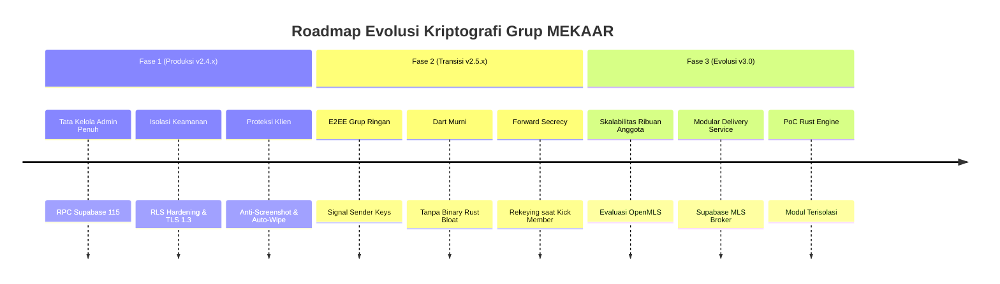

# 🛡️ Cetak Biru & Roadmap Strategis: Tinjauan Penerapan OpenMLS & E2EE Grup (MEKAAR 3.0)

**Dokumen**: Tinjauan Kriptografi & Rencana Kerja Bertahap  
**Target Sistem**: MEKAAR 3.0 (Flutter + Rust + Supabase)  
**Status**: Konseptual / Draft Roadmap  
**Tanggal**: 12 November 2026  

---

## 1. Latar Belakang & Urgensi

MEKAAR 3.0 memposisikan diri sebagai aplikasi obrolan keselamatan personal (*personal safety chat app*).
Saat ini:
- **Obrolan 1:1, Guardian, dan Chat Diri Sendiri** telah dilindungi oleh **End-to-End Encryption (E2EE) Murni** berbasis kurva eliptis **X25519 (ECDH)**, penurunan kunci **HKDF-SHA256**, dan cipher simetris terotentikasi **XChaCha20-Poly1305** (*fail-closed, zero-knowledge server*).
- **Obrolan Grup** saat ini diamankan melalui kombinasi **Transport Layer Security (TLS 1.3)**, **PostgreSQL Row-Level Security (RLS)** yang ketat, dan **Proteksi Klien** (*FLAG_SECURE anti-screenshot*, *disappearing messages*, dan *vault cloaking*).

Dokumen ini membedah kelayakan penerapan standar terbuka generasi terbaru **OpenMLS (IETF RFC 9420 - Messaging Layer Security)** sebagai solusi E2EE grup jangka panjang, membandingkannya dengan alternatif seperti *Signal Sender Keys*, serta menetapkan roadmap implementasi bertahap yang paling rasional dan aman dari kegagalan operasional.

---

## 2. Analisis Kriptografi: OpenMLS (TreeKEM / RFC 9420)

### A. Konsep Inti TreeKEM
OpenMLS menyusun kunci publik anggota grup ke dalam struktur pohon biner sinkron (*Asynchronous Ratcheting Tree*):
1. **Daun (*Leaf Nodes*)**: Mewakili masing-masing perangkat anggota grup.
2. **Simpul Cabang (*Parent Nodes*)**: Menyimpan kunci privat/publik turunan dari anak-anaknya.
3. **Akar (*Root Node*)**: Menghasilkan **Group Secret Key** untuk enkripsi pesan simetris massal.

### B. Keunggulan Matematis
* **Skalabilitas Sub-linear $O(\log N)$**: Operasi penambahan anggota (*Add*), pembaruan (*Update*), dan pengeluaran anggota (*Remove*) hanya memerlukan pembaharuan jalur langsung (*direct path*) dari simpul daun ke akar. Sangat efisien untuk grup berisi ratusan hingga ribuan anggota.
* **Post-Compromise Security (PCS)**: Begitu anggota mengirimkan pembaruan (*epoch commit*), kunci grup di-ratchet ulang secara otomatis. Penyerang yang sempat mencuri kunci masa lalu tidak dapat mendekripsi percakapan berikutnya.
* **Standarisasi IETF Terbuka**: Didukung oleh Mozilla, Cisco, Wire, Google, Meta, dan INRIA, bebas dari monopoli algoritma proprietary.

---

## 3. Matriks Perbandingan: OpenMLS vs. Signal Sender Keys vs. Status Quo

| Dimensi Evaluasi | OpenMLS (RFC 9420) | Signal Sender Keys | Status Quo MEKAAR (TLS + RLS) |
| :--- | :---: | :---: | :---: |
| **Kerahasiaan Server (Zero Knowledge)** | **100% Penuh** | **100% Penuh** | Sebagian (Server memegang ciphertext) |
| **Beban Bandwidth Kirim Pesan** | $O(1)$ simetris | $O(1)$ simetris | $O(1)$ |
| **Beban Bandwidth Kick / Rekey** | **$O(\log N)$ sangat efisien** | $O(N)$ kirim ulang kunci | $O(1)$ via database RPC |
| **Ketahanan Jaringan Lemah & Offline** | Rentan desinkronisasi *Epoch* | **Sangat Andal & Toleran** | **Sangat Andal** |
| **Overhead Ukuran Binary Aplikasi** | **+15 MB s/d +25 MB** (Rust FFI NDK) | **0 MB** (Dart cryptography) | **0 MB** |
| **Kompleksitas State Recovery** | **Tinggi** (Pohon rusak = Kunci hilang) | **Rendah** (Pairwise re-request) | **Nol** (Database driven) |
| **Tingkat Kesiapan Implementasi** | Perlu PoC & Delivery Service | Siap diintegrasikan | **Sudah Produksi (v2.4)** |

---

## 4. Analisis Risiko & Blind Spot Khusus Safety App

1. **Risiko Desinkronisasi *Epoch* pada Situasi Darurat**:
   - Jika pengguna berada di daerah minim sinyal dan melewatkan banyak pembaruan *epoch* grup, ponsel wajib memproses seluruh rantai *commit* secara berurutan.
   - Jika terjadi kegagalan pemrosesan pohon lokal, pesan darurat (SOS) berisiko gagal terdekripsi atau gagal terkirim. Dalam konteks aplikasi keselamatan, kegagalan ini berkategori fatal (*catastrophic failure*).
2. **Binary Bloat & Hambatan Perangkat Menengah Bawah**:
   - Menyematkan binary native Rust FFI (`.so` untuk 4 arsitektur Android dan iOS) memperbesar ukuran unduhan APK sebesar 15–25 MB. Hal ini kontraproduktif bagi pengguna target dengan perangkat terbatas di daerah suburban/pedesaan.
3. **Konflik Komit Serentak (*Commit Collisions*)**:
   - Supabase harus difungsikan sebagai *Delivery Service (DS)* yang menyediakan pengurutan linier mutlak (*strict serialization*). Dua admin yang mengeksekusi aksi grup bersamaan akan memicu *commit conflict* yang membutuhkan logika pemulihan (*re-base*) rumit di sisi klien.

---

## 5. Roadmap Pelaksanaan Bertahap

### Fase 1: Tata Kelola Mandiri & Hardening RLS (Status: Selesai di v2.4.13)
* Memanfaatkan PostgreSQL RPC `SECURITY DEFINER` (Migration 115) untuk moderasi grup (Promote/Demote Admin, Transfer Ownership, Kick Member, Leave Guard, Announcement Mode).
* Mempertahankan keandalan pengiriman pesan darurat 100% tanpa risiko desinkronisasi kripto lokal.

### Fase 2: Implementasi *Sender Keys* Berbasis Dart Murni (Target: v2.5.x)
* Mengadopsi arsitektur *Signal Sender Keys* menggunakan paket `cryptography` Dart yang sudah ada di aplikasi.
* Setiap anggota mendistribusikan kunci pengirimnya via saluran E2EE 1:1 yang sudah aktif.
* Saat anggota dikeluarkan atau keluar dari grup, kunci pengirim di-ratchet ulang (*re-keying*) sehingga mantan anggota tidak bisa membaca obrolan selanjutnya.
* Keuntungan: Ukuran aplikasi tetap ramping, tahan offline, dan mencapai E2EE grup 100%.

### Fase 3: Evaluasi & PoC OpenMLS (Target: v3.0)
* Jika grup komunitas publik (skala ratusan hingga ribuan orang) dibuka di masa mendatang.
* Mengembangkan modul Rust terisolasi via `flutter_rust_bridge` dan membangun microservice *MLS Delivery Service* di backend Supabase.

---

## 6. Kesimpulan Strategis

OpenMLS adalah standar masa depan yang sangat elegan secara matematis, namun memerlukan kesiapan infrastruktur *Delivery Service* dan penanganan *state machine* yang matang. Untuk menjaga keandalan pesan darurat pada MEKAAR saat ini, pendekatan transisi bertahap (**Fase 1 menuju Fase 2 Sender Keys murni**) adalah strategi terbaik dengan rasio risiko-imbalan (*risk-reward*) paling optimal.
