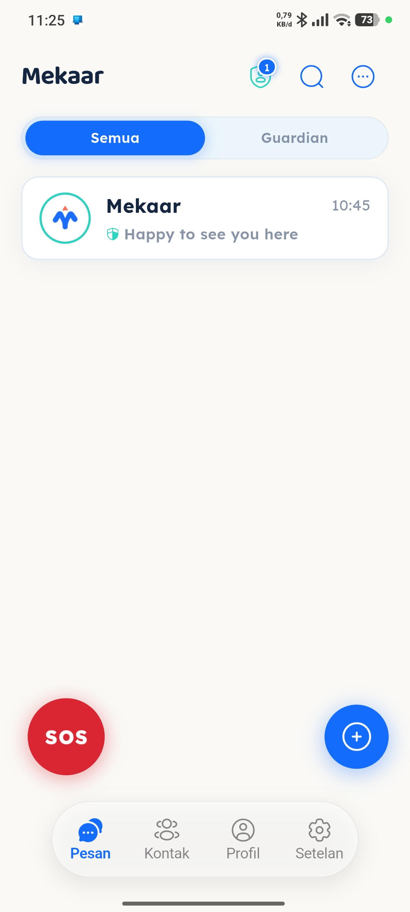
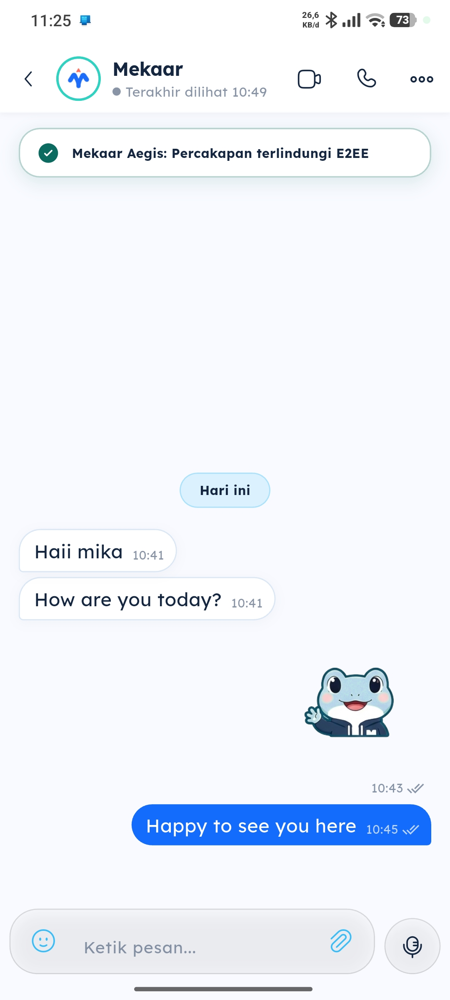
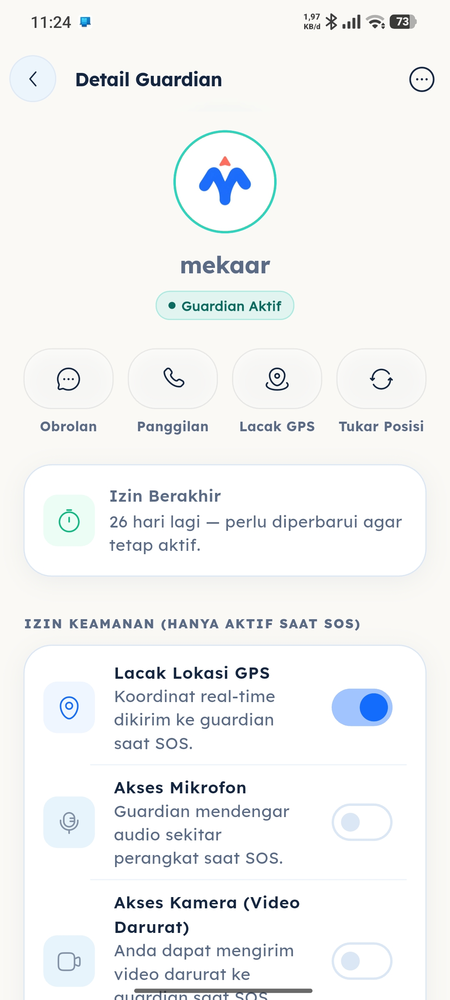
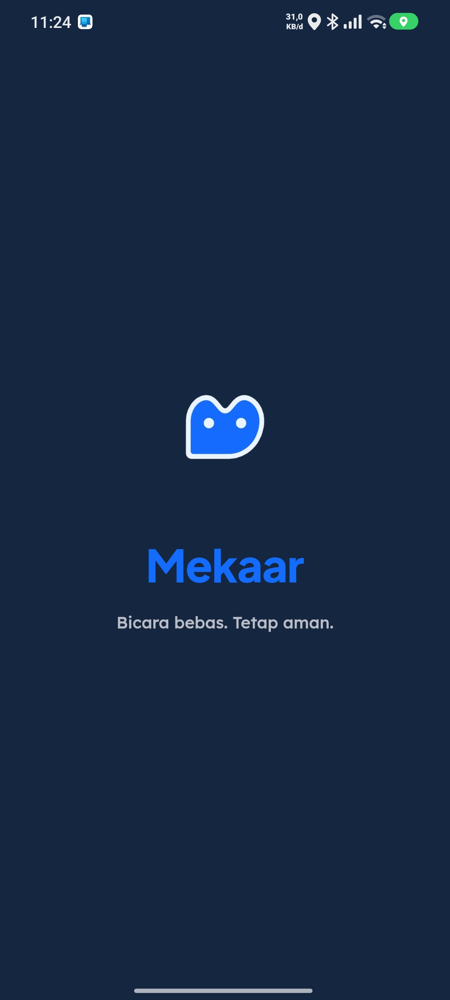
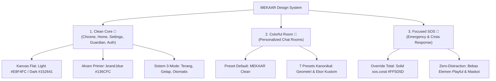
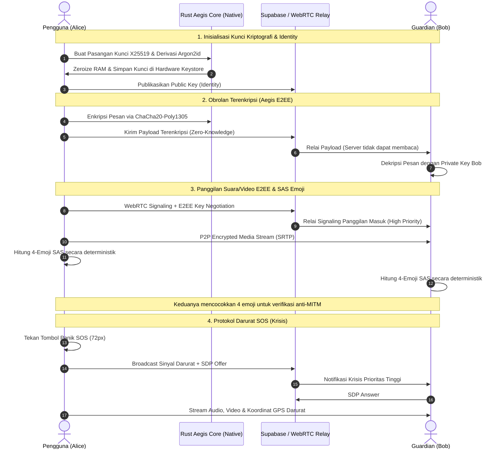

<div align="center">

  

  # MEKAAR 2.0
  ### Next-Gen Privacy-First Messenger & Autonomous Personal Safety Network

  <p align="center">
    <b>Zero-Knowledge Cryptography meets Real-Time Crisis Lifeline.</b><br/>
    Built for those who value uncompromising private communication and trusted guardian protection.
  </p>

  <!-- Badges -->
  <p align="center">
    <a href="https://flutter.dev"></a>
    <a href="https://www.rust-lang.org"></a>
    <a href="https://supabase.com"></a>
    <a href="https://webrtc.org"></a>
    <br/>
    <a href="https://github.com/tholeteplok/Mekaar_chat"></a>
    <a href="https://github.com/tholeteplok/Mekaar_chat/actions"></a>
    <a href="LICENSE"></a>
  </p>

  <!-- Quick Nav Navigation -->
  <p align="center">
    <a href="#-tampilan-aplikasi"><b>Tampilan Aplikasi</b></a> •
    <a href="#-mengapa-mekaar"><b>Mengapa MEKAAR?</b></a> •
    <a href="#-arsitektur-desain-tri-register"><b>Desain Tri-Register</b></a> •
    <a href="#-fitur-unggulan"><b>Fitur Utama</b></a> •
    <a href="#-keamanan--kriptografi"><b>Keamanan & Privasi</b></a> •
    <a href="#-arsitektur-teknis"><b>Arsitektur</b></a> •
    <a href="#-panduan-instalasi-quick-start"><b>Instalasi</b></a> •
    <a href="#-dukungan-pengembangan"><b>Donasi</b></a>
  </p>

</div>

---

## 📱 Tampilan Aplikasi (*Showcase*)

<div align="center">
  <table>
    <tr>
      <td align="center" width="25%">
        <br/>
        <sub><b>1. Clean Core</b><br/>Chat List & Tombol SOS</sub>
      </td>
      <td align="center" width="25%">
        <br/>
        <sub><b>2. Aegis E2EE Chat</b><br/>Percakapan Aman Terlindungi</sub>
      </td>
      <td align="center" width="25%">
        <br/>
        <sub><b>3. Jaringan Guardian</b><br/>Izin Keselamatan Saling Menjaga</sub>
      </td>
      <td align="center" width="25%">
        <br/>
        <sub><b>4. Filosofi Privasi</b><br/>"Bicara Bebas. Tetap Aman."</sub>
      </td>
    </tr>
  </table>
  <p><sub><i>*Tangkapan layar resolusi penuh dapat dilihat pada folder <a href="docs/screenshots/">docs/screenshots/</a>.</i></sub></p>
</div>

---

## 💡 Mengapa MEKAAR? (*The Problem & Solution*)

Aplikasi perpesanan konvensional dirancang hanya untuk obrolan teks sehari-hari dan seringkali mengeksploitasi metadata pengguna. Sementara itu, aplikasi keselamatan keluarga umumnya bertindak seperti alat mata-mata (*spyware*) yang melacak lokasi pengguna secara non-stop tanpa privasi.

**MEKAAR memecahkan paradoks ini dengan konvergensi unik:**
1. **Zero-Knowledge Privacy:** Pesan teks, media, dan panggilan dienkripsi ujung-ke-ujung (E2EE). Tidak ada seorang pun—termasuk server Supabase atau relay penyedia jaringan—yang dapat membaca percakapan atau mendengar panggilan Anda.
2. **Consent-Based Safety (Bukan Spyware):** Lokasi, kamera, dan audio Anda **tidak pernah** dipantau oleh Guardian dalam kondisi normal. Akses darurat hanya terbuka secara eksplisit saat Anda sendiri mengaktifkan mode darurat SOS atau sesi Quick Trip/Hangout yang disepakati.
3. **One-Tap Survival:** Ketika bahaya nyata terjadi, satu ketukan mengaktifkan sirene, streaming audio/video WebRTC secara instan ke lingkaran pelindung, dan menyiarkan koordinat GPS darurat tanpa jeda.

---

## 🎨 Arsitektur Desain Tri-Register

MEKAAR 2.0 mengadopsi filosofi visual **Tri-Register** untuk menjamin kejernihan fungsi, kenyamanan membaca, dan urgensi penyelamatan:



1. **Clean Core 🤍 (Navigasi, Beranda, Kontak, Pengaturan):**
   * Menggunakan palet `brand.blue` (`#136CFC`), `brand.darkBlue` (`#152641`), dan `brand.lightBlue` (`#E8F4FC`).
   * Menghilangkan gradien visual berat agar antarmuka bernapas lega (*breathable*).
   * Tipografi modern menggunakan *Plus Jakarta Sans* dengan hierarki visual yang tegas dan nyaman dibaca.
2. **Colorful Room 🎨 (Ruang Percakapan):**
   * **7 Presets Kanonikal:** *Mekaar Clean, Comic Pop, Neumorphic, Cyber Dark, Sunset Glow, Mecha Style, dan Pixel Craft*.
   * Setiap preset memiliki spesifikasi geometris unik: bentuk sudut (*chamfer/voxel/curved*), ekor gelembung (*beak/sharp/cut*), dan aksen visual tersentralisasi tanpa *hardcoded styling*.
3. **Focused SOS 🚨 (Protokol Krisis & Penyelamatan Jiwa):**
   * **Instant Canvas Override:** Seketika tombol SOS ditekan, seluruh antarmuka berubah menjadi solid `sos.coral` (`#FF5D5D`) / `sos.deep` (`#D92632`).
   * Menghilangkan semua animasi bermain, maskot, dan konfeti demi memprioritaskan tindakan cepat penyelamatan.

---

## 🌟 Fitur Unggulan

### 💬 1. Obrolan Aman & Bebas Jejak (*Private Messaging*)
* 🔐 **Aegis Protocol E2EE:** Enkripsi ujung-ke-ujung penuh berbasis kurva eliptis asimetris **X25519** dan cipher otentikasi **ChaCha20-Poly1305**. Kunci kriptografi dibuat dan tersimpan aman di Secure Keystore lokal perangkat Anda.
* 🛡️ **3-Slot Private Vault Isolation (Master, Decoy, Duress):** Sembunyikan kontak dan ruang obrolan sensitif ke dalam slot persona terpisah (Slot 1, Slot 2, Slot 3).
* 🚨 **Duress PIN Mode:** Masukkan PIN paksaan khusus untuk membuka mode *Decoy* seketika jika dipaksa pihak ketiga, sekaligus mengirim sinyal darurat senyap (*silent SOS*) ke Guardian tanpa menimbulkan kecurigaan.
* ⚡ **0ms Anti-Flash Cloaking:** Kontak dan ruang obrolan rahasia terfilter secara sinkron di memori (Frame 0), menghilangkan celah kedipan tampilan visual sebelum pembacaan disk selesai.
* 👁️ **View-Once Media:** Foto, video, dan rekaman suara sekali lihat langsung dikaburkan (*blurred*) dan otomatis dihapus permanen dari memori setelah ditonton.
* ⏳ **Disappearing Messages & Burn on Exit:** Timer pembersihan riwayat obrolan otomatis (1 Jam, 1 Hari, 7 Hari, atau Selamanya) serta opsi pemusnahan seketika saat keluar dari ruangan obrolan.
* 🚫 **Anti-Screenshot & Forwarding Guard:** Proteksi penangkapan layar dua arah dan pencegahan penerusan pesan (*anti-forwarding*) pada ruang percakapan privat.

### 📞 2. Panggilan Suara & Video E2EE (*Encrypted WebRTC Calling*)
* 🔒 **End-to-End Encrypted Calling:** Panggilan suara dan video dua arah dilindungi enkripsi penuh titik-ke-titik.
* 🔏 **4-Emoji SAS Verification:** Verifikasi keaslian sambungan secara visual dengan *Short Authentication String* berupa 4 emoji deterministik simetris untuk menjamin tidak adanya serangan penyadapan di tengah jalan (*Man-In-The-Middle*).
* 🔔 **Native Android Incoming Ringtone:** Notifikasi panggilan masuk prioritas tinggi dengan dering sistem dan integrasi tombol jawab/tolak di layar kunci.
* 🧹 **Call History Auto-Reconciliation & Purge:** Riwayat panggilan lokal dan server tersinkronisasi presisi tanpa duplikasi atau riwayat lama yang tertinggal.

### 🛡️ 3. Jaringan Saling Menjaga (*Guardian Network*)
* 🤝 **Consent-Based Security:** Lingkaran pelindung (keluarga/sahabat terpercaya) hanya menerima data darurat saat Anda mengizinkannya secara sadar.
* 📍 **Safety Route & Quick Trip:** Bagikan estimasi kepulangan (ETA) dan rute perjalanan terencana saat bepergian malam atau melewati daerah rawan.
* 🔄 **Dynamic Role Swapping ("Dijaga & Menjaga"):** Persetujuan simetris dua arah untuk saling memantau keselamatan antar anggota.
* 📡 **Nearby Friends Radar:** Deteksi teman terdekat secara anonim dengan visual radar interaktif tanpa membuka lokasi eksak secara publik.

### 🚨 4. Respon Darurat Terpadu (*SOS Panic Engine*)
* 🔘 **72px Pulsing Panic Button:** Tombol panik darurat dengan umpan balik haptik instan yang mudah diakses di segala kondisi krisis.
* 📹 **Real-Time WebRTC Video & Audio Stream:** Siaran langsung umpan kamera dan mikrofon berlatensi sangat rendah langsung ke layar Guardian.
* 🗺️ **GPS Live Tracking (OpenStreetMap):** Pembaruan koordinat presisi tinggi tanpa ketergantungan pada Google Maps proprietary.
* 📴 **Device Lost Protection:** Kunci perangkat jarak jauh, aktifkan sirene berdesibel tinggi, dan tampilkan pesan pemulihan pemilik.

---

## 🔒 Keamanan & Kriptografi

| Komponen | Spesifikasi Teknis | Standar Keamanan / Manfaat |
|---|---|---|
| **Key Exchange (KEX)** | Diffie-Hellman over Curve25519 (X25519) | RFC 7748 |
| **Symmetric Cipher** | ChaCha20-Poly1305 AEAD | RFC 8439 (Zero-Knowledge Payload) |
| **Key Derivation (KDF)** | Argon2id + PBKDF2 Hybrid Fallback | Tahan serangan perangkat keras ASIC/GPU |
| **Memory Protection** | Zeroize on Drop (Rust Native Memory Guard) | Pencegahan kebocoran kunci pada memory dump RAM |
| **File Shredder** | Multi-pass DoD 5220.22-M Overwriting | Pemusnahan data fisik media & database anti-forensik |
| **Call Verification (SAS)** | 4-Emoji Short Authentication String | Verifikasi visual anti Man-In-The-Middle (MITM) |
| **Device Storage** | Android Keystore / iOS Keychain (`flutter_secure_storage`) | Hardware-backed TPM / Secure Enclave |
| **Passcode Hashing** | SHA-256 + 32-Byte Dynamic Salt + Lockout (5x salah = 30 menit) | Perlindungan Anti-Bruteforce berlapis |
| **Push Notification Privacy** | Native OS Drop Guard + Encrypted Payload Disguise | Nol bocoran isi pesan atau nama kontak ke log server FCM |
| **Network Security** | TLS 1.3 + Supabase Row Level Security (RLS) + WebRTC SRTP | Otorisasi ketat berbasis baris data pada PostgreSQL |

---

## 🛠️ Arsitektur Teknis



### Tech Stack:
* **Frontend:** Flutter 3.x (Dart 3.x)
* **Native Security Engine:** Rust Aegis Core (`rust/` via `flutter_rust_bridge`)
* **State Management:** Riverpod (`StateNotifierProvider`, `StreamProvider`, `FutureProvider`)
* **Database & Auth:** Supabase (PostgreSQL 15+, Row Level Security, Realtime WebSockets)
* **Realtime Media & Calls:** WebRTC (`flutter_webrtc`), `record`, `audioplayers`
* **Geospatial & Mapping:** OpenStreetMap via `flutter_map` & `latlong2`
* **Penyimpanan Lokal Terenkripsi:** SQLCipher (`sqflite_sqlcipher`), `flutter_secure_storage`

---

## 📂 Struktur Direktori Proyek

```text
Mekaar_chat/
├── android/             # Konfigurasi native Android, Push Services, Call Receivers
├── assets/              # Logo, ikon kripto, suara sirene/pesan, ilustrasi Mika
├── docs/                # Dokumentasi arsitektur & tangkapan layar repositori
│   └── screenshots/     # Mockup tampilan aplikasi untuk README
├── lib/
│   ├── core/            # Token tema (colors, typography), rute (AppRoutes), shared widgets
│   ├── data/            # Model data, repository Supabase, database SQLCipher, WebRTC engine
│   └── features/
│       ├── auth/        # Otentikasi, PIN Lock, 3-Slot Vault, Duress PIN, Splash Screen
│       ├── chat/        # Ruang obrolan, Vault Aktif, 7 tema kanonikal, view-once, media
│       ├── guardian/    # Lingkaran "Dijaga & Menjaga", radar teman sekitar, rute aman
│       ├── map/         # Pelacakan peta darurat OpenStreetMap (OSM)
│       ├── settings/    # Pengaturan privasi, kamuflase vault, donasi kripto, tentang
│       └── sos/         # Layar darurat terpadu, WebRTC live stream, anti-kehilangan HP
├── rust/                # Rust Aegis Core (Argon2id, Memory Zeroize, DoD Shredder, Stream Cipher)
├── supabase/
│   └── migrations/      # Skrip migrasi SQL terurut (01 s/d 114)
└── test/                # Unit test, widget test & security test suite (700+ tests)
```

---

## 🚀 Panduan Instalasi (*Quick Start*)

### 1. Prasyarat Sistem
* Flutter SDK (Versi `>= 3.19.0` disarankan)
* Rust Toolchain (`cargo` & `rustc`) untuk kompilasi modul Aegis Core
* Akun atau Instansi Mandiri (*Self-Hosted*) **Supabase**

### 2. Konfigurasi Basis Data
Jalankan berkas migrasi SQL yang berada di `supabase/migrations/` secara berurutan pada **SQL Editor** Supabase Anda:
```bash
# Migrasi dimulai dari 01_initial_schema.sql hingga 114_purge_expired_calls_on_disappearing_hours.sql
```

### 3. Konfigurasi Variabel Lingkungan (`.env`)
Salin atau buat file `.env` di direktori *root* proyek (file ini diabaikan oleh Git):
```env
SUPABASE_URL=https://your-project-id.supabase.co
SUPABASE_ANON_KEY=your-supabase-anon-key-here
```

### 4. Menjalankan Aplikasi & Pengujian
```bash
# 1. Unduh seluruh dependensi Flutter & Dart
flutter pub get

# 2. Jalankan rangkaian tes Rust Core
cd rust && cargo test && cd ..

# 3. Jalankan rangkaian tes otomatis Flutter (700+ Unit, Widget & Security Tests)
flutter test

# 4. Jalankan aplikasi pada perangkat atau emulator
flutter run
```

> [!TIP]
> **Konfigurasi WebRTC / TURN (Wajib untuk Produksi):**  
> Pada rilis produksi, berikan parameter TURN credential melalui `--dart-define` saat build APK agar panggilan dapat melewati NAT ketat dan firewall seluler:  
> `flutter build apk --dart-define=TURN_URL=turn:... --dart-define=TURN_USERNAME=... --dart-define=TURN_CREDENTIAL=...`  
> Pada mode debug (`kDebugMode`), aplikasi otomatis fallback ke relay publik `openrelay.metered.ca`.

---

## 💙 Dukungan Pengembangan (*Crypto Donation*)

MEKAAR dikembangkan sebagai sistem keselamatan personal independen **tanpa iklan**, **tanpa pelacak analitik komersial**, dan **tanpa monetisasi data pengguna**.

Bila Anda ingin mendukung pemeliharaan server *relay*, infrastruktur WebRTC, dan riset kriptografi, Anda dapat berkontribusi melalui alamat dompet berikut:

<div align="center">

| Jaringan / Token | Alamat Dompet (*Wallet Address*) |
|---|---|
| **Solana (SOL & SPL Tokens)** | `8NygxsjfWmcDMMTVuBS2VSAq7b6MnfGTqsPutCfLobyk` |
| **EVM Multi-Chain (ETH, Base, Arbitrum, Polygon, BNB)** | `0x49a2013dcbb322079e18136e25e39ab940a74c5e` |
| **TRON (TRX & USDT-TRC20)** | `TBQf6zEfjhsBbcAAyam626JED3ordfX6Y1` |
| **Bitcoin (BTC Native SegWit / Taproot)** | `bc1pywldcavnzq7ztmsqvm8unq3rkrlzafvenzhgmsvz7t32ysq0lcvqmcwfvw` |

</div>

<sub>*Alamat di atas juga dapat disalin dengan 1 ketukan langsung melalui menu <b>Pengaturan ➔ Tentang MEKAAR</b> di dalam aplikasi.*</sub>

---

## 📄 Lisensi

Didistribusikan di bawah lisensi terbuka [MIT License](LICENSE).  
Hak atas privasi data dan keselamatan personal Anda adalah prioritas utama kami.
