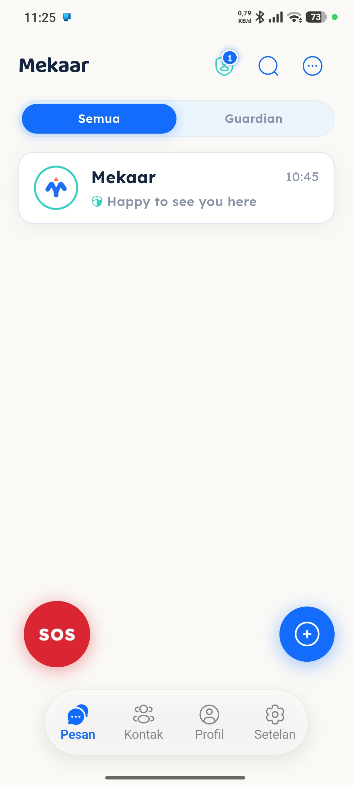
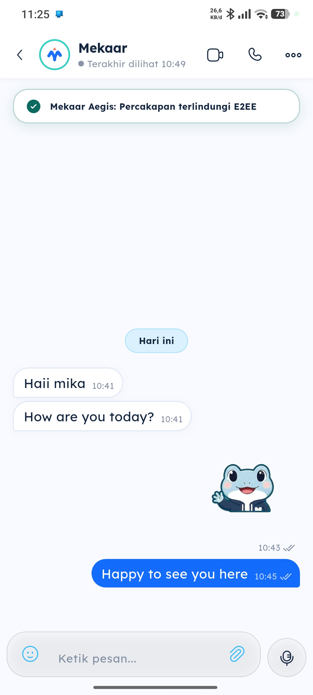
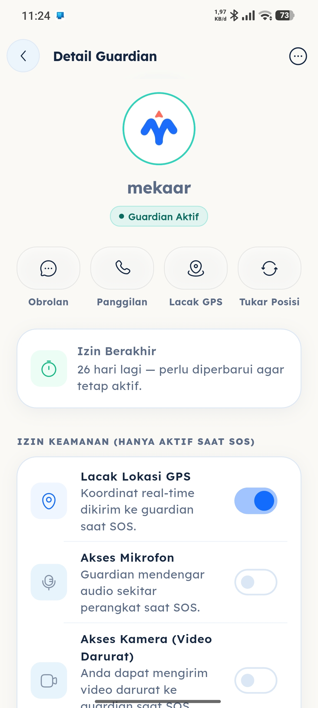
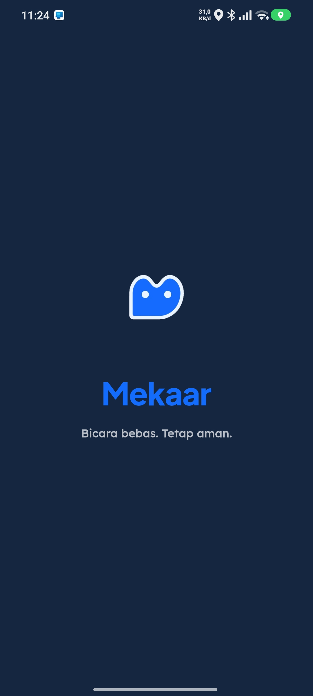
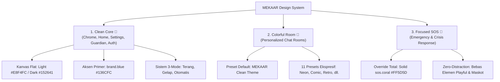
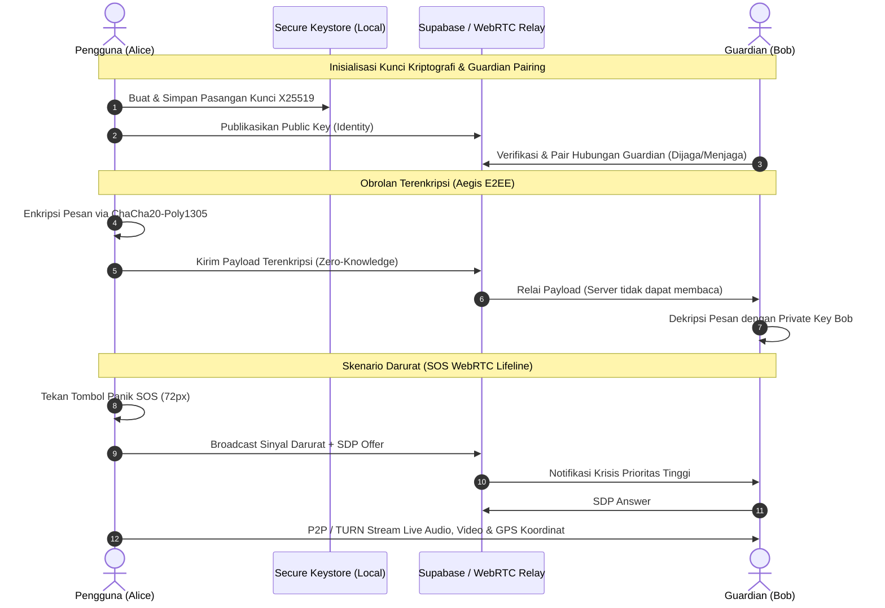

<div align="center">

  

  # MEKAAR 3.0
  ### Next-Gen Privacy-First Messenger & Autonomous Personal Safety Network

  <p align="center">
    <b>Zero-Knowledge Cryptography meets Real-Time Crisis Lifeline.</b><br/>
    Built for those who value uncompromising private communication and trusted guardian protection.
  </p>

  <!-- Badges -->
  <p align="center">
    <a href="https://flutter.dev"></a>
    <a href="https://dart.dev"></a>
    <a href="https://supabase.com"></a>
    <a href="https://webrtc.org"></a>
    <br/>
    <a href="https://github.com/tholeteplok/Mekaar_chat"></a>
    <a href="https://github.com/tholeteplok/Mekaar_chat/actions"></a>
    <a href="LICENSE"></a>
  </p>

  <!-- Quick Nav Navigation -->
  <p align="center">
    <a href="#-tampilan-aplikasi"><b>Tampilan Aplikasi</b></a> •
    <a href="#-mengapa-mekaar"><b>Mengapa MEKAAR?</b></a> •
    <a href="#-arsitektur-desain-tri-register"><b>Desain Tri-Register</b></a> •
    <a href="#-fitur-unggulan"><b>Fitur Utama</b></a> •
    <a href="#-keamanan--kriptografi"><b>Keamanan & Privasi</b></a> •
    <a href="#-arsitektur-teknis"><b>Arsitektur</b></a> •
    <a href="#-panduan-instalasi-quick-start"><b>Instalasi</b></a> •
    <a href="#-dukungan-pengembangan"><b>Donasi</b></a>
  </p>

</div>

---

## 📱 Tampilan Aplikasi (*Showcase*)

<div align="center">
  <table>
    <tr>
      <td align="center" width="25%">
        <br/>
        <sub><b>1. Clean Core</b><br/>Chat List & Tombol SOS</sub>
      </td>
      <td align="center" width="25%">
        <br/>
        <sub><b>2. Aegis E2EE Chat</b><br/>Percakapan Aman Terlindungi</sub>
      </td>
      <td align="center" width="25%">
        <br/>
        <sub><b>3. Jaringan Guardian</b><br/>Izin Keselamatan Saling Menjaga</sub>
      </td>
      <td align="center" width="25%">
        <br/>
        <sub><b>4. Filosofi Privasi</b><br/>"Bicara Bebas. Tetap Aman."</sub>
      </td>
    </tr>
  </table>
  <p><sub><i>*Tangkapan layar resolusi penuh dapat dilihat pada folder <a href="docs/screenshots/">docs/screenshots/</a>.</i></sub></p>
</div>

---

## 💡 Mengapa MEKAAR? (*The Problem & Solution*)

Aplikasi perpesanan konvensional dirancang hanya untuk obrolan teks sehari-hari dan seringkali mengeksploitasi metadata pengguna. Sementara itu, aplikasi keselamatan keluarga umumnya bertindak seperti alat mata-mata (*spyware*) yang melacak lokasi pengguna secara non-stop tanpa privasi.

**MEKAAR memecahkan paradoks ini dengan konvergensi unik:**
1. **Zero-Knowledge Privacy:** Pesan dan media dienkripsi ujung-ke-ujung (E2EE). Tidak ada seorang pun—termasuk pengembang server—yang dapat membaca percakapan Anda.
2. **Consent-Based Safety (Bukan Spyware):** Lokasi, kamera, dan audio Anda **tidak pernah** dipantau oleh Guardian dalam kondisi normal. Akses darurat hanya terbuka secara eksplisit saat Anda sendiri mengaktifkan mode darurat SOS atau sesi Hangout yang disepakati.
3. **One-Tap Survival:** Ketika bahaya nyata terjadi, satu ketukan mengaktifkan sirene, streaming audio/video WebRTC secara instan ke lingkaran pelindung, dan menyiarkan koordinat GPS darurat tanpa jeda.

---

## 🎨 Arsitektur Desain Tri-Register

MEKAAR 3.0 mengadopsi filosofi visual **Tri-Register** untuk menjamin kejernihan fungsi, kenyamanan membaca, dan urgensi penyelamatan:



1. **Clean Core 🤍 (Navigasi, Beranda, Kontak, Pengaturan):**
   * Menggunakan palet `brand.blue` (`#136CFC`), `brand.darkBlue` (`#152641`), dan `brand.lightBlue` (`#E8F4FC`).
   * Menghilangkan gradien visual berat agar antarmuka bernapas lega (*breathable*).
   * Tipografi modern menggunakan *Plus Jakarta Sans* dengan hierarki visual yang tegas dan nyaman dibaca.
2. **Colorful Room 🎨 (Ruang Percakapan):**
   * **MEKAAR Clean Theme:** Tema bawaan minimalis dengan kontras gelembung pesan yang ergonomis.
   * **11 Presets Ekspresif:** *Neon Dreams, Comic Pop Art, Neumorphism, Glassmorphism, Pixel Garden 8-Bit, Candy Pop, Retro Wave, Mono Vibe, Solarpunk, Kunang-kunang, dan Buku Harian*.
3. **Focused SOS 🚨 (Protokol Krisis & Penyelamatan Jiwa):**
   * **Instant Canvas Override:** Seketika tombol SOS ditekan, seluruh antarmuka berubah menjadi solid `sos.coral` (`#FF5D5D`) / `sos.deep` (`#D92632`).
   * Menghilangkan semua animasi bermain, maskot, dan konfeti demi memprioritaskan tindakan cepat penyelamatan.

---

## 🌟 Fitur Unggulan

### 💬 1. Obrolan Aman & Bebas Jejak (*Private Messaging*)
* 🔐 **Aegis Protocol E2EE:** Enkripsi ujung-ke-ujung penuh berbasis kurva eliptis asimetris **X25519** dan cipher otentikasi **ChaCha20-Poly1305**. Kunci kriptografi dibuat dan tersimpan aman di Secure Keystore lokal perangkat Anda.
* 👁️ **View-Once Media:** Foto, video, dan rekaman suara sekali lihat langsung dikaburkan (*blurred*) dan otomatis dihapus permanen dari memori setelah ditonton.
* ⏳ **Disappearing Messages:** Timer pembersihan riwayat obrolan otomatis (1 Jam, 1 Hari, 7 Hari, atau Selamanya).
* 🛡️ **Private Vault Cloaking:** Sembunyikan obrolan sensitif di balik PIN sekunder terenkripsi dengan banner sesi pintar terpusat.
* 🚫 **Anti-Screenshot & Recording Guard:** Proteksi penangkapan layar dua arah pada ruang percakapan privat.

### 🛡️ 2. Jaringan Saling Menjaga (*Guardian Network*)
* 🤝 **Consent-Based Security:** Lingkaran pelindung (keluarga/sahabat terpercaya) hanya menerima data darurat saat Anda mengizinkannya secara sadar.
* 📍 **Safety Route & Hangout Sharing:** Bagikan estimasi kepulangan dan lokasi sementara secara terencana saat bepergian malam atau menghadiri pertemuan baru.
* 🔄 **Dynamic Role Swapping ("Dijaga & Menjaga"):** Persetujuan simetris dua arah untuk saling memantau keselamatan antar anggota.
* 📡 **Nearby Friends Radar:** Deteksi teman terdekat secara anonim dengan visual radar interaktif.

### 🚨 3. Respon Darurat Terpadu (*SOS Panic Engine*)
* 🔘 **72px Pulsing Panic Button:** Tombol panik darurat dengan umpan balik haptik instan yang mudah diakses di segala kondisi krisis.
* 📹 **Real-Time WebRTC Video & Audio Stream:** Siaran langsung umpan kamera dan mikrofon berlatensi sangat rendah langsung ke layar Guardian.
* 🗺️ **GPS Live Tracking (OpenStreetMap):** Pembaruan koordinat presisi tinggi tanpa ketergantungan pada Google Maps proprietary.
* 📴 **Device Lost Protection:** Kunci perangkat jarak jauh, aktifkan sirene berdesibel tinggi, dan tampilkan pesan pemulihan pemilik.

---

## 🔒 Keamanan & Kriptografi

| Komponen | Spesifikasi Teknis | Standar Keamanan |
|---|---|---|
| **Key Exchange (KEX)** | Diffie-Hellman over Curve25519 (X25519) | RFC 7748 |
| **Symmetric Cipher** | ChaCha20-Poly1305 AEAD | RFC 8439 |
| **Key Derivation** | HKDF (HMAC-SHA256) | RFC 5869 |
| **Device Storage** | Android Keystore / iOS Keychain (`flutter_secure_storage`) | Hardware-backed TPM |
| **Passcode Hashing** | SHA-256 + Local Salt + Lockout Brute-force (5x salah = 30 menit) | Anti-Bruteforce Guard |
| **Network Security** | TLS 1.3 + Supabase Row Level Security (RLS) + WebRTC SRTP | Zero-Knowledge Architecture |

---

## 🛠️ Arsitektur Teknis



### Tech Stack:
* **Frontend:** Flutter 3.x (Dart 3.x)
* **State Management:** Riverpod (`StateNotifierProvider`, `StreamProvider`, `FutureProvider`)
* **Database & Auth:** Supabase (PostgreSQL 15+, Row Level Security, Realtime Engine)
* **Media & Audio:** WebRTC (`flutter_webrtc`), `record`, `audioplayers`
* **Geospatial & Mapping:** OpenStreetMap via `flutter_map` & `latlong2`
* **Keamanan Lokal:** `flutter_secure_storage`, `crypto`

---

## 📂 Struktur Direktori Proyek

```text
Mekaar_chat/
├── assets/              # Logo, ikon kripto, suara sirene/pesan, ilustrasi Mika
├── docs/                # Dokumentasi arsitektur & screenshot repositori
│   └── screenshots/     # Mockup tampilan aplikasi untuk README
├── lib/
│   ├── core/            # Token tema (colors, typography), rute (AppRoutes), shared widgets
│   ├── data/            # Model data, repository Supabase, enkripsi E2EE, WebRTC engine
│   └── features/
│       ├── auth/        # Otentikasi, PIN Lock, Duress PIN, Splash Screen
│       ├── chat/        # Ruang obrolan, Vault Aktif, selector tema 12 preset, lampiran
│       ├── guardian/    # Lingkaran "Dijaga & Menjaga", radar teman sekitar, rute aman
│       ├── map/         # Pelacakan peta darurat OpenStreetMap (OSM)
│       ├── settings/    # Pengaturan privasi, kamuflase vault, donasi kripto, tentang
│       └── sos/         # Layar darurat terpadu, WebRTC live stream, anti-kehilangan HP
├── supabase/
│   └── migrations/      # Skrip migrasi database SQL terurut (01 s/d terbaru)
└── test/                # Unit test, widget test & WebRTC signaling test (237 tests)
```

---

## 🚀 Panduan Instalasi (*Quick Start*)

### 1. Prasyarat Sistem
* Flutter SDK (Versi `>= 3.19.0` disarankan)
* Akun atau Instansi Mandiri (Self-Hosted) **Supabase**

### 2. Konfigurasi Basis Data
Jalankan berkas migrasi SQL yang berada di `supabase/migrations/` secara berurutan pada **SQL Editor** Supabase Anda:
```bash
# Migrasi dimulai dari 01_initial_schema.sql hingga berkas migrasi nomor tertinggi
```

### 3. Konfigurasi Variabel Lingkungan (`.env`)
Salin atau buat file `.env` di direktori *root* proyek (file ini diabaikan oleh Git):
```env
SUPABASE_URL=https://your-project-id.supabase.co
SUPABASE_ANON_KEY=your-supabase-anon-key-here
```

### 4. Menjalankan Aplikasi & Pengujian
```bash
# 1. Unduh seluruh dependensi proyek
flutter pub get

# 2. Jalankan rangkaian tes otomatis (Unit & Widget Test)
flutter test

# 3. Jalankan aplikasi pada perangkat atau emulator
flutter run
```

> [!TIP]
> **Konfigurasi WebRTC / TURN (Wajib untuk Produksi):**  
> Pada rilis produksi, berikan parameter TURN credential melalui `--dart-define` saat build APK:  
> `flutter build apk --dart-define=TURN_URL=turn:... --dart-define=TURN_USERNAME=... --dart-define=TURN_CREDENTIAL=...`  
> Pada mode debug (`kDebugMode`), aplikasi otomatis fallback ke relay terbuka pengembang.

---

## 💙 Dukungan Pengembangan (*Crypto Donation*)

MEKAAR dikembangkan sebagai sistem keselamatan personal independen **tanpa iklan**, **tanpa pelacak analitik komersial**, dan **tanpa monetisasi data pengguna**.

Bila Anda ingin mendukung pemeliharaan server *relay*, infrastruktur WebRTC, dan riset kriptografi, Anda dapat berkontribusi melalui alamat dompet berikut:

<div align="center">

| Jaringan / Token | Alamat Dompet (*Wallet Address*) |
|---|---|
| **Solana (SOL & SPL Tokens)** | `8NygxsjfWmcDMMTVuBS2VSAq7b6MnfGTqsPutCfLobyk` |
| **EVM Multi-Chain (ETH, Base, Arbitrum, Polygon, BNB)** | `0x49a2013dcbb322079e18136e25e39ab940a74c5e` |
| **TRON (TRX & USDT-TRC20)** | `TBQf6zEfjhsBbcAAyam626JED3ordfX6Y1` |
| **Bitcoin (BTC Native SegWit / Taproot)** | `bc1pywldcavnzq7ztmsqvm8unq3rkrlzafvenzhgmsvz7t32ysq0lcvqmcwfvw` |

</div>

<sub>*Alamat di atas juga dapat disalin dengan 1 ketukan langsung melalui menu <b>Pengaturan ➔ Tentang MEKAAR</b> di dalam aplikasi.*</sub>

---

## 📄 Lisensi

Didistribusikan di bawah lisensi terbuka [MIT License](LICENSE).  
Hak atas privasi data dan keselamatan personal Anda adalah prioritas utama kami.
