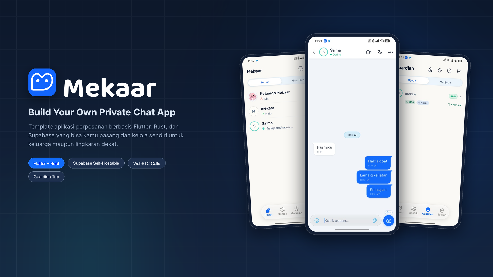
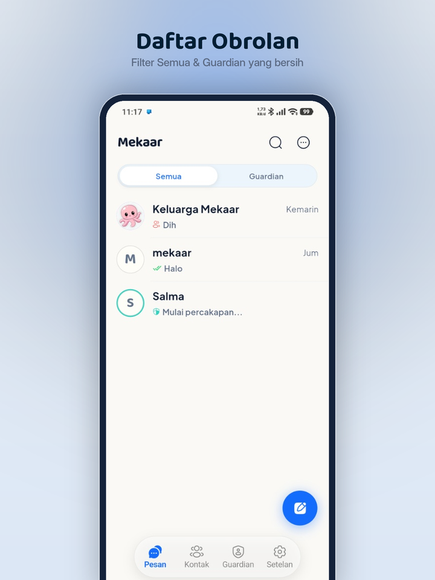
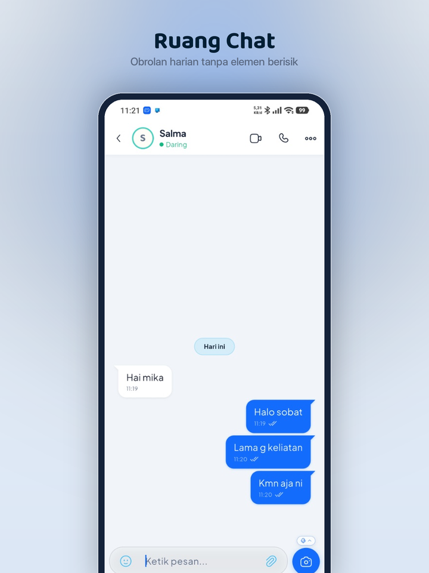
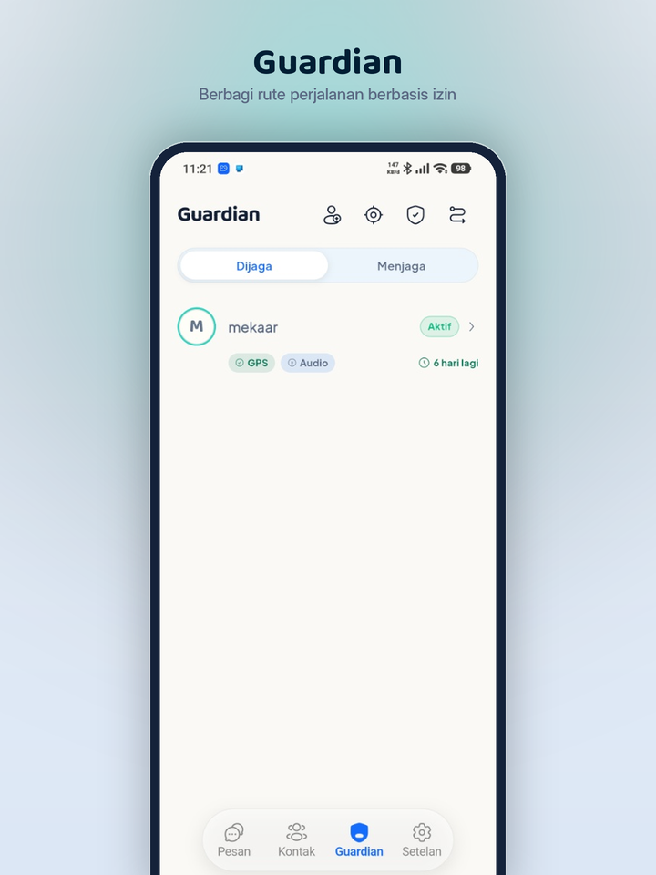
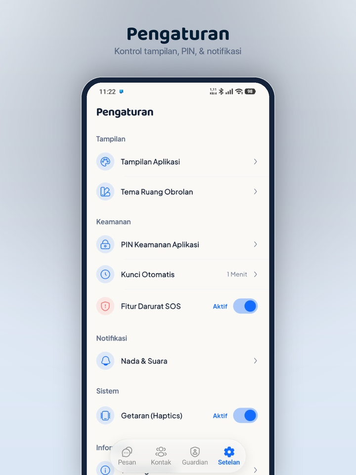
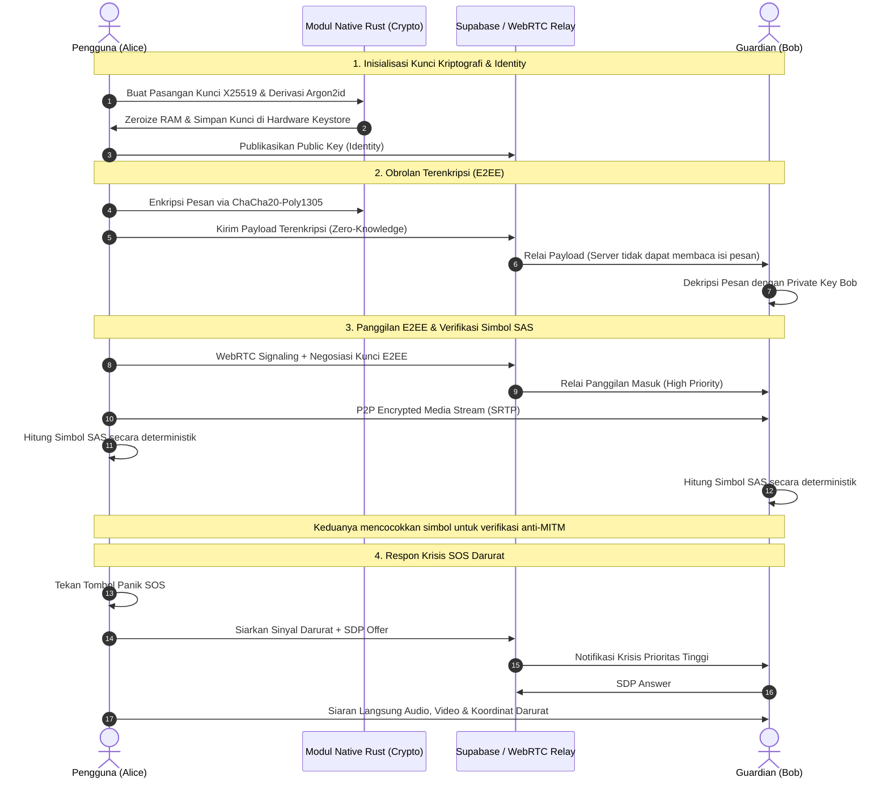

<div align="center">

# MEKAAR 2.0

**Build Your Own Private Chat App**

Template aplikasi perpesanan berbasis Flutter, Rust, dan Supabase yang bisa kamu pasang dan kelola sendiri untuk keluarga, pasangan, atau lingkaran dekat.

<p align="center">
  <a href="https://flutter.dev"></a>
  <a href="https://www.rust-lang.org"></a>
  <a href="https://supabase.com"></a>
  <a href="https://webrtc.org"></a>
  <a href="LICENSE"></a>
</p>

[Tampilan](#tampilan) • [Desain](#desain) • [Fitur](#fitur) • [Keamanan](#keamanan--kriptografi) • [Tech Stack](#tech-stack) • [Cara Pasang](#cara-pasang-sendiri-quick-start) • [Catatan & Batasan](#catatan--batasan-teknis) • [Dukungan](#dukungan)

</div>

## Tampilan

<div align="center">
  
</div>

| Daftar Obrolan | Ruang Chat & Tema | Kabar Perjalanan (Guardian) | Pengaturan & Privasi |
| :---: | :---: | :---: | :---: |
|  |  |  |  |

## Desain

* **3 Mode Tampilan:** Mendukung mode **Terang (*Light*)**, **Gelap (*Dark*)**, dan **Hitam Pekat (*Stealth OLED*)** yang hemat baterai di layar AMOLED.
* **Tema Ruang Chat Kustom:** Pilihan warna dan bentuk sudut gelembung pesan yang bisa diatur berbeda untuk setiap ruang obrolan tanpa hardcoded styling.
* **Tata Letak Bersih & Ringan:** Menggunakan tipografi **Plus Jakarta Sans** dan **Space Grotesk** dengan fokus pada kemudahan membaca pesan tanpa iklan, tanpa pelacak analitik, dan tanpa elemen dekoratif yang mengganggu.

## Fitur

### Obrolan & Media
* **Pesan Harian Lengkap:** Mendukung teks, foto, video, dokumen, lokasi, dan pesan suara (*voice note*) dengan kontrol kecepatan putar (`1x`, `1.5x`, `2x`).
* **Interaksi Cepat:** *Swipe-to-reply* (geser untuk membalas), reaksi di pesan, pencarian pesan di dalam obrolan, draf lokal otomatis, dan arsip obrolan.
* **Media Sekali Lihat (*View-Once*):** Kirim foto, video, atau pesan suara yang otomatis terhapus dari ruang obrolan setelah dibuka satu kali oleh penerima.
* **Pesan Menghilang & Bersihkan Saat Keluar:** Atur timer penghapusan pesan otomatis (`1 Jam`, `1 Hari`, `7 Hari`) atau hapus riwayat lokal setiap kali menutup ruang obrolan (*Burn on Exit*).

### Panggilan Suara & Video
* **Panggilan Langsung (WebRTC):** Panggilan suara dan video dua arah antarperangkat tanpa perantara pihak ketiga.
* **Kode Verifikasi Panggilan:** Menampilkan 4 simbol di layar panggilan untuk dicocokkan dengan lawan bicara guna memastikan koneksi terhubung langsung dan bebas penyadapan (*anti-MITM*).
* **Integrasi Panggilan Masuk:** Mendukung layar panggilan masuk dengan nada dering sistem dan pencatatan riwayat panggilan.

### Privasi & Penyimpanan Lokal
* **Enkripsi Pesan Otomatis:** Isi pesan dan media dikunci di perangkat sebelum dikirim menggunakan `X25519` dan `ChaCha20-Poly1305`, lalu disimpan di perangkat dalam database lokal `SQLCipher`.
* **Kunci PIN & Ruang Kedua:** Kunci aplikasi dengan kode PIN, dilengkapi opsi PIN terpisah (*Decoy* & *Duress*) untuk membuka tampilan profil kedua atau mereset tampilan riwayat lokal saat diperlukan.
* **Batasi Tangkapan Layar:** Memanfaatkan `FLAG_SECURE` di Android untuk menonaktifkan fungsi *screenshot* sistem di dalam aplikasi dan menyamarkan layar di *App Switcher*.

### Kabar Perjalanan (*Guardian*) & Darurat (*SOS*)
* **Berbagi Rute Sementara (*Quick Trip*):** Bagikan rute perjalanan dan perkiraan waktu tiba (*ETA*) hanya saat kamu sedang di jalan kepada anggota keluarga atau teman dekat yang dipilih secara sadar (*Consent-Based*).
* **Teman di Sekitar (*Nearby Friends*):** Fitur opsional berbasis izin untuk melihat kontak yang sedang berada di sekitar tanpa memamerkan titik koordinat GPS mentah.
* **Sinyal Darurat (*SOS*):** Tombol darurat dengan hitung mundur pembatalan untuk mengirim lokasi GPS (*OpenStreetMap*) serta membuka siaran audio/video WebRTC ke kontak *Guardian*.
* **Bunyi Pencari HP:** Membunyikan nada dering keras dari dalam aplikasi untuk membantu mencari ponsel yang terselip atau lupa ditaruh di sekitar rumah.

## Keamanan & Kriptografi

| Komponen | Spesifikasi Teknis | Standar / Manfaat |
|---|---|---|
| Key Exchange (KEX) | Diffie-Hellman over Curve25519 (X25519) | RFC 7748 |
| Symmetric Cipher | ChaCha20-Poly1305 AEAD | RFC 8439 (Zero-Knowledge Payload) |
| Key Derivation (KDF) | Argon2id + PBKDF2 Hybrid Fallback | Tahan serangan perangkat keras ASIC/GPU |
| Memory Protection | Zeroize on Drop (Rust Native Memory Guard) | Pencegahan kebocoran kunci di memory dump RAM |
| File Shredder | Multi-pass DoD 5220.22-M Overwriting | Pemusnahan data fisik media anti-forensik |
| Call Verification (SAS) | 4-Emoji / Symbol Short Authentication String | Verifikasi visual anti Man-In-The-Middle (MITM) |
| Device Storage | Android Keystore / iOS Keychain | Hardware-backed TPM / Secure Enclave |
| Passcode Security | SHA-256 + 32-Byte Dynamic Salt + Lockout | 5x salah input = kunci otomatis 30 menit |
| Network Security | TLS 1.3 + Supabase Row Level Security (RLS) | Otorisasi ketat per-baris pada PostgreSQL |



## Tech Stack

Kamu memegang kendali penuh atas aplikasi dan database milikmu sendiri:

* **Aplikasi Klien:** Flutter 3.x (Dart 3.x) + Riverpod.
* **Modul Kriptografi Native:** Rust (`rust/` via `flutter_rust_bridge`).
* **Database & Relai Pesan:** Supabase (PostgreSQL, Row Level Security, Realtime WebSockets) — bisa menggunakan paket *Free Tier* Supabase Cloud atau *self-hosted* di server sendiri.
* **Database Lokal di HP:** SQLCipher (`sqflite_sqlcipher`) & `flutter_secure_storage`.
* **Panggilan & Peta:** `flutter_webrtc`, `record`, `audioplayers`, dan OpenStreetMap (`flutter_map`).

## Struktur Folder

```text
Mekaar_chat/
├── android/               # Konfigurasi Android, notifikasi, & layanan panggilan
├── assets/                # Font, ikon, audio dering, & ilustrasi
├── docs/                  # Dokumentasi publik & katalog sistem desain
│   ├── screenshots/       # Gambar mockup aplikasi untuk README
│   ├── DESIGN_SYSTEM_CATALOG.md # Kamus komponen & token sentral MEKAAR
│   └── design.md          # Spesifikasi filosofi desain visual
├── lib/
│   ├── core/              # Design tokens (colors, typography), rute, & widget umum
│   ├── data/              # Model data, repositori Supabase, SQLCipher, & WebRTC
│   └── features/
│       ├── auth/          # Login, layar PIN, & brankas ruang kedua
│       ├── chat/          # Daftar obrolan, ruang chat, voice note, & privasi chat
│       ├── guardian/      # Berbagi rute perjalanan & radar teman sekitar
│       ├── map/           # Peta OpenStreetMap & pemilih lokasi
│       ├── settings/      # Pengaturan tema, PIN, keamanan, & donasi
│       └── sos/           # Layar sinyal darurat & pencari HP terselip
├── rust/                  # Kode Rust untuk enkripsi pesan, hashing PIN, & utilitas memori
├── supabase/migrations/   # Skrip tabel database & aturan RLS Supabase (01 s/d 114)
└── test/                  # Pengujian otomatis (unit, widget, & guardrail tests)
```

## Cara Pasang Sendiri (Quick Start)

### 1. Yang Perlu Disiapkan
* **Flutter SDK** (`>= 3.19.0`)
* **Rust Toolchain** (`cargo` & `rustc`)
* **Akun Supabase** (Buat 1 proyek baru di [supabase.com](https://supabase.com) atau gunakan instansi *self-hosted*)

### 2. Siapkan Database Supabase
Buka menu **SQL Editor** di dashboard Supabase kamu, lalu jalankan skrip SQL yang ada di folder `supabase/migrations/` secara berurutan.

### 3. Atur File `.env`
Buat file `.env` di folder paling luar (*root*) proyek ini dan masukkan URL serta Anon Key dari proyek Supabase milikmu:
```env
SUPABASE_URL=https://id-proyek-kamu.supabase.co
SUPABASE_ANON_KEY=anon-key-supabase-kamu
```

### 4. Jalankan atau Build APK
```bash
# 1. Unduh paket dependensi Flutter
flutter pub get

# 2. Uji modul Rust (opsional)
cd rust && cargo test && cd ..

# 3. Uji unit, widget & guardrail Flutter
flutter test

# 4. Jalankan langsung di HP / Emulator
flutter run
```

> **Opsional — Server TURN untuk Panggilan WebRTC Lintas Jaringan:**  
> Agar panggilan suara/video tetap lancar saat kedua HP berada di jaringan seluler/NAT yang ketat, kamu bisa menambahkan kredensial server TURN saat mem-build APK:
> ```bash
> flutter build apk \
>   --dart-define=TURN_URL=turn:turn-server-kamu.com:3478 \
>   --dart-define=TURN_USERNAME=username_kamu \
>   --dart-define=TURN_CREDENTIAL=password_kamu
> ```

## Catatan & Batasan Teknis

Agar pengguna dan pengembang memahami cara kerja aplikasi ini secara apa adanya:

* **Apa yang Dienkripsi:** Isi pesan teks, suara, dan file media dienkripsi di perangkat sebelum dikirim ke Supabase. Namun, server Supabase tetap membutuhkan metadata dasar (seperti waktu pengiriman dan ID ruang obrolan) agar pesan bisa diteruskan ke penerima.
* **Batas Fitur Anti-Screenshot:** Pengaturan *Batasi Tangkapan Layar* menggunakan `FLAG_SECURE` dari sistem Android. Fitur ini mencegah *screenshot* dari tombol HP itu sendiri, tetapi tidak bisa mencegah orang memotret layar memakai kamera HP lain.
* **Fitur Pencari HP (`device_lost`):** Berfungsi membunyikan nada peringatan dan menampilkan pesan di dalam aplikasi Mekaar saat aplikasi berjalan, bukan fitur penguncian paksa tingkat sistem operasi (*OS Device Admin Lock*).
* **Audit Kode:** Proyek ini bersifat terbuka (*open-source*) untuk keperluan belajar dan penggunaan mandiri, serta belum menjalani audit kriptografi komersial dari lembaga pihak ketiga.

## Dukungan

Proyek ini dibuat dan dibagikan secara terbuka tanpa iklan. Jika kamu merasa terbantu dan ingin mendukung pengembangannya:

* **Solana (SOL & SPL):** `8NygxsjfWmcDMMTVuBS2VSAq7b6MnfGTqsPutCfLobyk`
* **EVM (ETH, Base, Arbitrum, Polygon, BNB):** `0x49a2013dcbb322079e18136e25e39ab940a74c5e`
* **TRON (TRX & USDT-TRC20):** `TBQf6zEfjhsBbcAAyam626JED3ordfX6Y1`
* **Bitcoin (BTC):** `bc1pywldcavnzq7ztmsqvm8unq3rkrlzafvenzhgmsvz7t32ysq0lcvqmcwfvw`

## Lisensi

Didistribusikan di bawah lisensi **MIT License**. Silakan gunakan, modifikasi, dan kembangkan sesuai kebutuhanmu.
